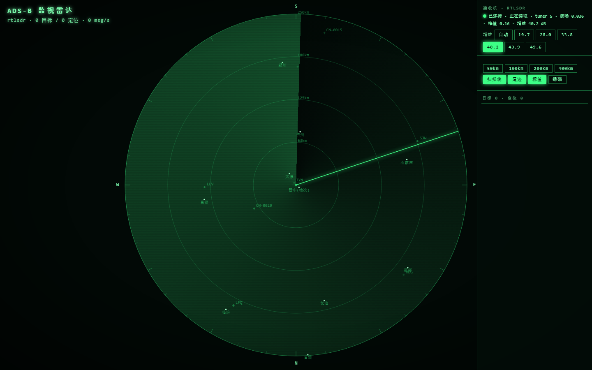

# ADS-B 监视雷达 · RTL-SDR V4

用 RTL-SDR Blog V4 接收附近空域 1090 MHz ADS-B 航班信号，并在浏览器里以**雷达荧光屏（PPI）风格**显示航迹：旋转扫描线、余辉拖尾、距离环、方位刻度，以及简略的线条地图（海岸线 / 国界 / 大型机场）。



---

## 一、工作原理

1. 飞机通过 1090 MHz（Mode S / ADS-B，DF17/18）广播身份、位置、高度、速度。
2. RTL-SDR V4 以 2.4 MSps 采样 1090 MHz 频段。
3. 程序解调并解码这些报文，用 **CPR 定位** 还原经纬度，逐架跟踪。
4. 本地网页服务把目标画成雷达画面：中心为天线，方位/距离投影，扫一圈“点亮”一次目标（荧光余辉）。

---

## 二、硬件准备（RTL-SDR V4）

### 1. 安装驱动（Windows）

RTL-SDR Blog V4 需要专用驱动：

1. 到 RTL-SDR Blog 官网 / GitHub 下载 **rtl-sdr-blog Windows 发布包**（内含 `Zadig` 和 `rtl_test.exe` 等工具）。
2. 插入 USB 接收棒，打开发布包里的 **Zadig**。
3. `Options → List All Devices`，选择 **`Bulk-In, Interface (Interface 0)`**（或 `RTL2838UHIDIR`），驱动选 **WinUSB**，点 Install。
4. 用发布包里的 `rtl_test -s 2400000` 验证能读到采样（看到不断增长的计数即成功）。

> V4 需要较新的 librtlsdr（≥ 0.8，含 R828D 支持）。发布包里的 DLL 已包含；若用 Python 的 `pyrtlsdr` 解调报“打不开设备 / 没有信号”，把发布包里的 `rtlsdr.dll`、`libusb-1.0.dll` 复制到项目根目录的 `bin\` 下（程序会自动优先加载）。

### 2. 天线：V 型偶极天线调成 1090 MHz

V 型偶极天线（套件里的伸缩天线）出厂一般按 137 MHz（气象卫星）设计，**用于 1090 MHz 需要缩短**：

- 每根振子拉出约 **6.9 cm**（半波长偶极，单臂 ≈ λ/4 = 69 mm）。
- 两臂夹角约 **120°**，整体尽量**竖直**放置（ADS-B 是垂直极化），放在窗边、高处、朝天空无遮挡。
- 1090 MHz 信号直线传播，尽量避开高楼遮挡，并远离电脑机箱/开关电源等噪声源。

---

## 三、软件安装

需要 Python 3.9+（Windows 下推荐官方安装包）。

```powershell
cd adsb-radar
python -m pip install -r requirements.txt
```

`numpy` 为必需；`pyrtlsdr` 仅在用「纯 Python 解调」数据源时需要（见下）。

---

## 四、运行

在项目目录 `adsb-radar\` 下：

```powershell
# 方式 B：纯 Python 直接解调（自包含，Windows 下 pip 装 pyrtlsdr + pyrtlsdrlib 即可）——本机推荐
python run.py --source rtlsdr --lat 37.72 --lon 112.66 --gain 40.2

# 方式 A：用 rtl_adsb（rtl-sdr 官方工具，最快，需单独下载工具包）
python run.py --source rtl_adsb --lat 37.72 --lon 112.66

# 方式 C：从局域网内的 dump1090 / readsb 转发（如树莓派）
python run.py --source network --host 192.168.1.20 --port-remote 30002

# 方式 D：无硬件，用仿真流量看效果
python run.py --source sim
```

打开浏览器访问 **http://127.0.0.1:8080/**（端口可用 `--port` 改）。

> **先自检**：`python tools\test_receiver.py --gain 40.2` 抓几秒数据，看到 `CRC-valid > 0` 就说明整条链路通了；一直是 0 多半是天线没调好。

> `--lat/--lon` 是天线的经纬度（小数度），本项目已按晋中榆次大学城填了 `37.72, 112.66`（`config.json`），可按实际位置微调。填了坐标后才有地图线条和“单帧快速定位”。

### 增益怎么调

- 默认 `--gain 40.2`（固定增益，比 `auto`/AGC 更适合 ADS-B 脉冲）。
- 增益太高会**削波**（满量程），产生大量假信号反而更慢/更乱；太高就往下调（如 33.8、29.7）。
- 附近无强干扰时可用 49.6（最大）；有本地强信号时用 40 左右更稳。

### 常用参数

| 参数 | 说明 |
|------|------|
| `--source` | `rtl_adsb` / `rtlsdr` / `network` / `sim` |
| `--lat --lon` | 天线经纬度 |
| `--range` | 雷达半径 km（默认 250） |
| `--gain` | 增益，如 `auto` 或 `49.6` |
| `--ppm` | 频率校正（晶体偏差 ppm） |
| `--port` | 网页端口（默认 8080） |
| `--sim-n` | 仿真目标数量 |

也可以把常用设置写进项目目录的 `config.json`（可选，键名与命令行参数一致），命令行参数会覆盖它。例如：

```json
{"source": "rtl_adsb", "lat": 31.23, "lon": 121.47, "range_km": 300, "gain": "auto"}
```

---

## 五、雷达界面

- **扫描线**：绿色亮线按 4 秒一圈旋转；目标被扫到时最亮，随后余辉衰减（荧光屏效果）。
- **目标**：三角为航向，短线为速度矢量；数据块显示 呼号 / 高度(FL) / 地速 / 距离 / 方位。
- **线条地图**：海岸线、国界、大型机场（需填 `--lat/--lon` 且 `web/data/` 有数据）。
- 右侧面板：目标列表（点击锁定）、范围切换（50/100/200/400 km）、扫描线/尾迹/标签开关、绿色/琥珀配色。

地图数据可用 `python tools\fetch_map_data.py` 重新下载生成（需要联网）。

---

## 六、目录结构

```
adsb-radar/
├── run.py                 # 入口
├── adsbradar/
│   ├── demod.py           # 1090MHz PPM 解调（readsb/dump1090 demod_2400 的移植）
│   ├── crc.py             # Mode S CRC-24 校验
│   ├── decode.py          # DF17/18 报文解析（呼号/高度/速度/CPR）
│   ├── cpr.py             # CPR 全局+局部定位
│   ├── tracker.py         # 航迹状态机（成对 CPR、尾迹、过期）
│   ├── sources.py         # 数据源：rtl_adsb / pyrtlsdr / 网络 / 仿真
│   ├── server.py          # 本地 HTTP + JSON 状态
│   └── web/               # 雷达前端（Canvas，无外部依赖）
├── tools/fetch_map_data.py
├── tests/                 # 单元测试（含真实报文向量）
└── requirements.txt
```

---

## 七、常见问题

- **`--source rtlsdr` 报 “Error loading librtlsdr”**：缺 DLL。执行 `pip install pyrtlsdrlib`（它自带编译好的 librtlsdr 0.8git，支持 V4 的 R828D）。
- **收不到任何目标**：先跑 `python tools\test_receiver.py` 看 `CRC-valid`；为 0 时检查天线是否每臂 6.9 cm、竖直、靠窗，增益调到 40~49.6（太高会削波）。
- **tuner 显示 R820T/2（而不是 R828D）**：V4 的 R828D 在较新 librtlsdr 里常显示为 R820T/2，对 1090 MHz 接收无影响（R828D 只在 <24 MHz 短波需要特殊初始化）。
- **`--source rtlsdr` 打不开设备**：检查 Zadig 是否给 `Bulk-In, Interface 0` 装了 WinUSB；`Get-PnpDevice` 里该接口的驱动 Provider 应为 `libwdi`。
- **地图空白**：说明没填 `--lat/--lon`，或 `web/data/` 下没有数据文件（运行 `python tools\fetch_map_data.py` 生成）。
- **只有少数飞机**：1090 MHz 直线传播，高度越高、遮挡越少收得越远；范围环设为 200–400 km 更合适。

> 安全与合规：仅用于接收民航 ADS-B 广播（公开信号）。请遵守当地无线电相关法规。
