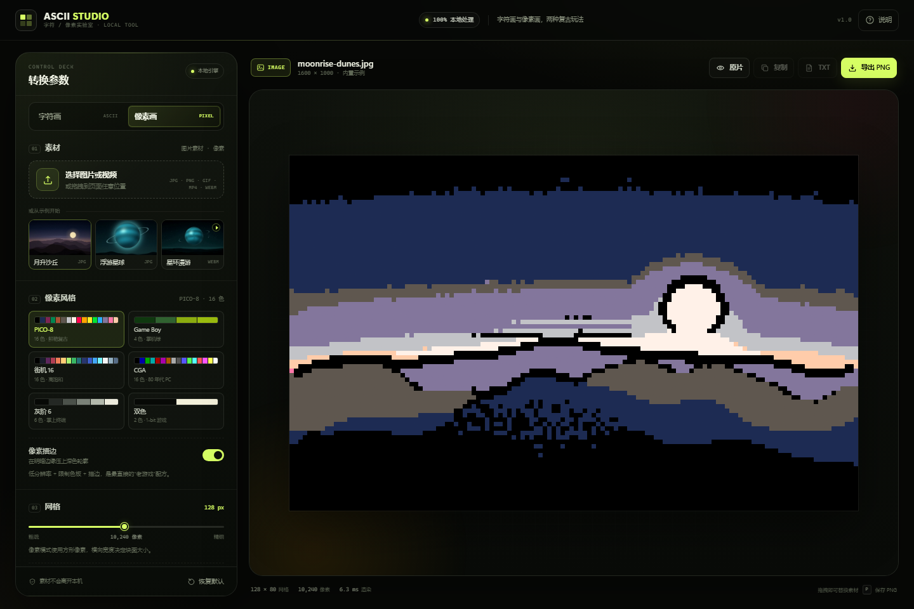
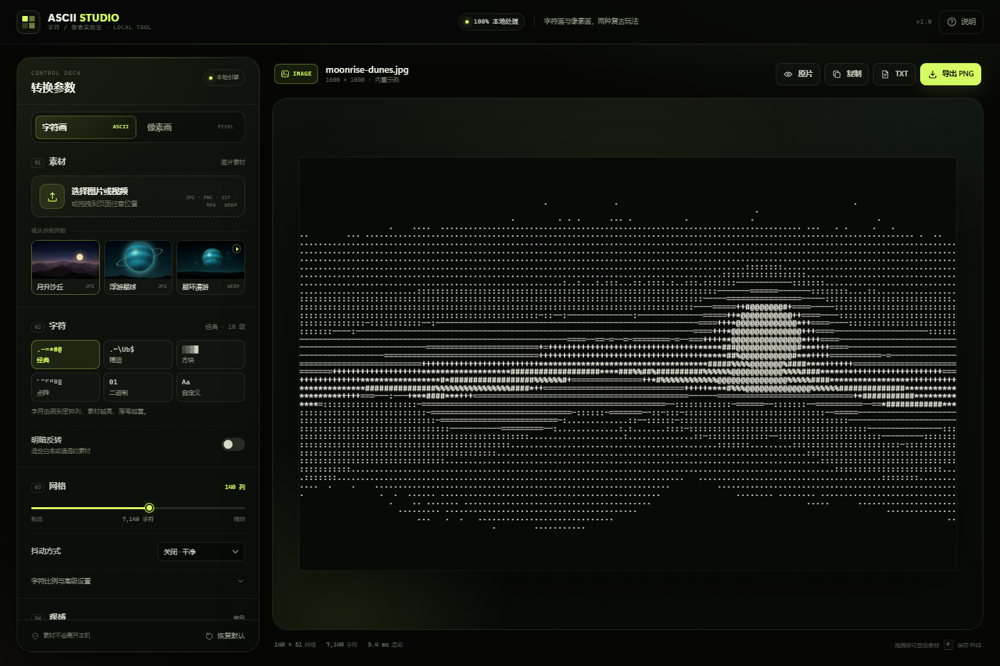
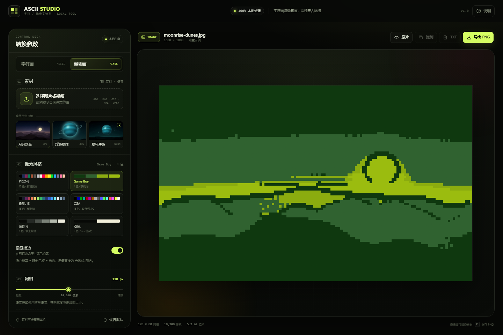
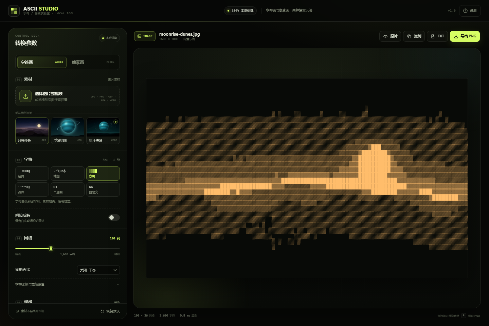
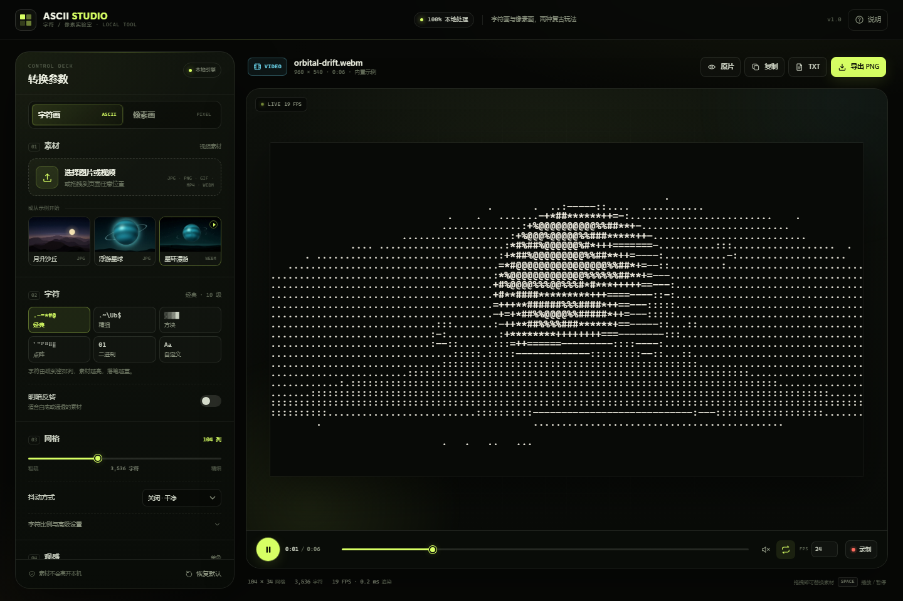
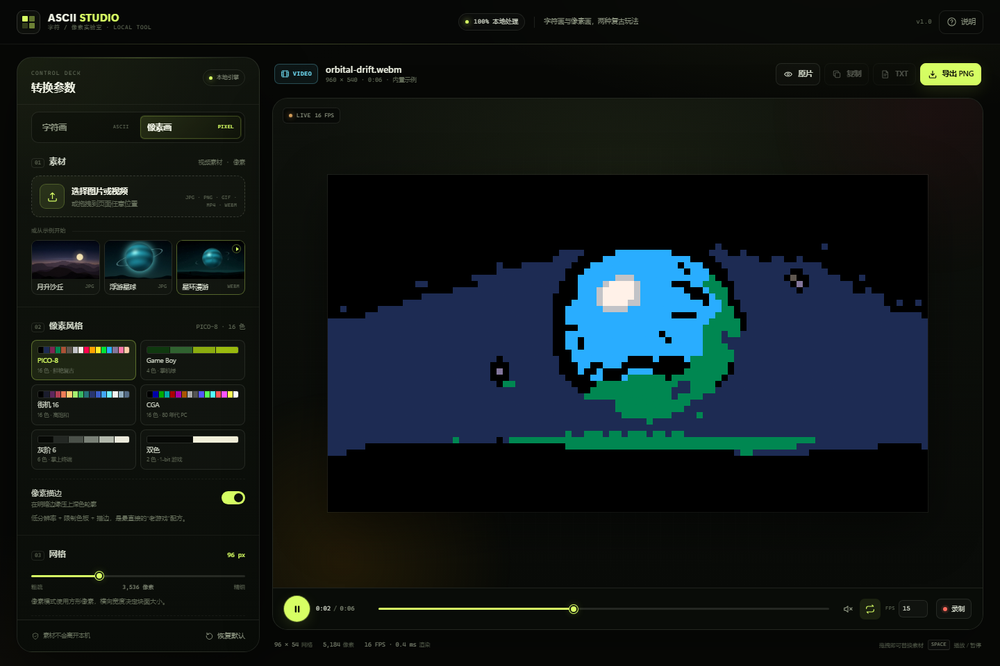
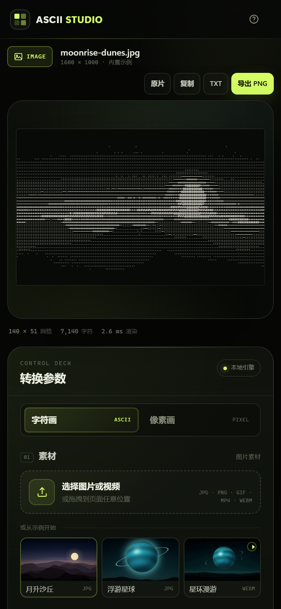
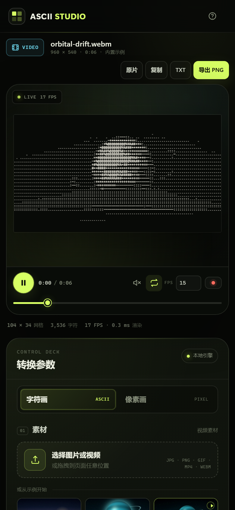
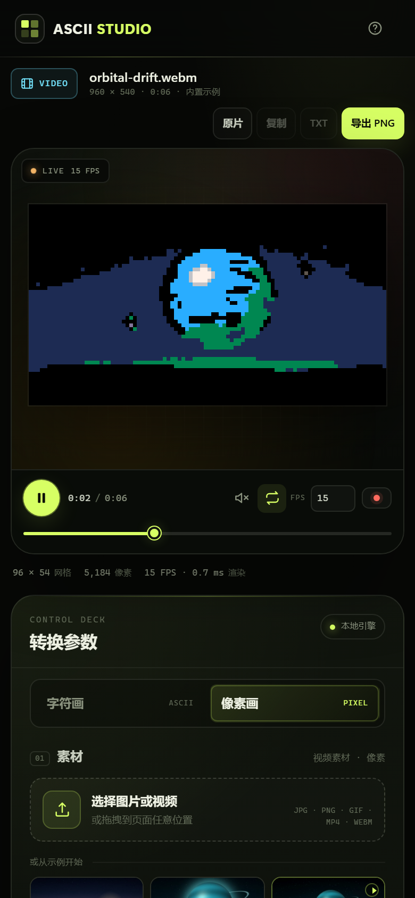

# ASCII STUDIO

把图片和视频，变成字符画，或古早平面像素游戏。

一个完全在浏览器本地运行的视觉转换工作台：拖入素材，选择「字符画 / 像素画」，调好密度、颜色与明暗，导出 PNG / TXT，或把正在播放的动画录制成视频。零外部依赖，不需要构建，也不上传任何文件。



## 两种风格

| 字符画模式 | 像素游戏模式 |
| --- | --- |
|  |  |

- **字符画**：把每个采样格映射成字符，支持 5 套预设字符集与自定义字符，可单色或保留原色。
- **像素画**：使用方形像素 + 限制色板 + 抖动 + 可选描边，做出 PICO-8、Game Boy、街机、CGA、灰阶、双色等复古游戏质感。

## 功能

### 通用

- 支持图片与视频素材；所有处理都在浏览器本地完成
- 实时预览，拖动列数滑杆即时重绘
- 自动增强、亮度、对比度、抖动方式等参数在两种模式间共享
- 参数自动保存在 localStorage，下次打开继续使用
- 响应式布局，桌面、平板、手机都能用
- 视频支持播放、暂停、拖动进度、循环、原片对照与录制

### 字符画

- 5 套预设字符集：经典、精细、方块、点阵、二进制，外加自定义字符
- 明暗反转、有序抖动、误差扩散
- 单色模式可换 5 种字符颜色；原色模式保留画面色彩并提亮阴影
- 亮度、对比度、字符宽高比等细调参数
- 导出高清 PNG、带 BOM 的 TXT，或直接复制字符

### 像素画

- 6 套复古色板：PICO-8 16 色、Game Boy 4 色、街机 16 色、CGA 16 色、灰阶 6 色、双色
- 方形像素、横向像素宽 40–220，自动按原图比例计算行数
- 可选「像素描边」：在明暗交界处压上色板最暗的颜色，强化物体轮廓
- 抖动可选关闭 / 有序 / 误差扩散，用限制色板模拟渐变
- 像素模式导出高清 PNG，并支持视频逐帧录制
- 像素模式没有文本输出，复制与 TXT 会自动禁用

### 视频

- 支持浏览器可解码的 MP4 / WebM / MOV / OGV 等格式
- 载入后静音自动播放，可暂停、拖动进度、切换循环
- 可调节目标渲染帧率（10 / 15 / 20 / 24 / 30 FPS）
- 原片对照小窗，随时确认还原效果
- 把当前动画录制为 WebM / MP4（取决于浏览器 MediaRecorder 支持）
- 未静音且浏览器支持捕获音轨时，录制会带上原始声音；静音时只录画面

## 快速开始

### 环境

- Node.js **18 或更高版本**
- 推荐使用最新版 Edge 或 Chrome
- 不需要 `npm install`，项目没有第三方运行时依赖

### 启动

**Windows：** 双击 `start.cmd`。脚本会启动本地服务并自动打开浏览器。

**macOS / Linux / 有 Node 的任何环境：**

```bash
node server.js
```

然后访问终端里打印的地址（默认 <http://127.0.0.1:4173/>）。按 `Ctrl+C` 停止服务。

如果 4173 被占用，服务会自动尝试后续端口，以终端输出为准。

> 请不要直接双击 `index.html` 使用。浏览器对 `file://` 下的示例素材、视频分段加载和录屏有额外限制，走本地服务最稳。

### 使用方法

1. **载入**：点击「选择素材」、把文件拖到页面任意位置，或从 3 个内置示例里挑一个。
2. **选风格**：在左侧顶部的「字符画 / 像素画」间切换；像素模式再选一套复古色板。
3. **调节**：列数决定密度，抖动改善渐变，自动增强控制明暗层次。视频还能拖动进度、切换帧率。
4. **带走**：字符画可复制 / TXT / PNG；像素画导出 PNG。视频场景下都可以点播放器右侧的「录制」保存动画。

## 界面说明

| 区域 | 说明 |
| --- | --- |
| 模式切换 | 在字符画与像素画之间切换，参数会分别保留 |
| 左侧控制台 | 素材、风格、网格、观感参数，所有改动实时生效 |
| 预览舞台 | 实时画布；左上角 LIVE 表示视频正在逐帧渲染 |
| 播放器 | 播放/暂停、时间轴、音量、循环、目标 FPS、录制 |
| 底部读数 | 网格尺寸、字符数/像素数、单帧转换耗时与实时帧率 |

### 参数

- **字符集**（字符画）：决定画面笔触。经典最像传统终端字符画；方块更适合看形状；精细适合细节多的照片。
- **像素色板**（像素画）：限制可选颜色，数量越少越有早年掌机味。PICO-8 色彩最丰富，Game Boy / 双色最克制。
- **像素描边**（像素画）：在明显明暗边缘画上深色轮廓，更像游戏 sprite。
- **列数**：越高越细，计算量也越大。字符画默认图片 140 列 / 视频 104 列；像素画默认图片 128 px / 视频 96 px。
- **抖动**：给渐变加入颗粒，改善平滑区域的色带。找不到合适效果时保持「关闭」即可。
- **自动增强**：把素材的实际明暗范围拉伸到完整范围；视频会锁定首帧的色阶，避免逐帧忽明忽暗。
- **原色 / 单色**（仅字符画）：单色渲染无论原图多暗都清晰可读；原色保留素材色彩并提亮阴影。
- **字符比例**（字符画高级设置）：单字宽高比，默认 0.58，适合等宽字体。像素模式固定为方形像素。

## 导出

| 格式 | 说明 |
| --- | --- |
| PNG | 两种模式都支持；按当前参数重新渲染高清图 |
| TXT | 仅字符画；UTF-8 BOM + CRLF 换行，Windows 记事本可直接打开 |
| 复制 | 仅字符画；把字符画放进剪贴板 |
| 视频录制 | 两种模式都支持；按当前参数从片头逐帧录制，3 分钟上限；默认 WebM，浏览器只支持 MP4 时自动切换 |

录制时请留意：

- 录制会从视频开头重新开始，按目标帧率实时进行。
- 想保留原声，请在录制前取消静音；静音状态下只录制画面。
- 录制过程中参数、模式与素材入口会暂时锁定，避免画面尺寸变化。

## 快捷键

| 快捷键 | 操作 |
| --- | --- |
| `Space` | 视频播放 / 暂停 |
| `P` | 保存 PNG |
| `C` | 复制字符画（仅字符画模式） |
| `Ctrl` / `⌘` + `V` | 粘贴剪贴板里的图片 |
| `Esc` | 关闭原片对照 / 说明弹窗 |
| `?` | 打开使用说明 |

## 更多截图

| 字符画调参 | 视频字符动画 |
| --- | --- |
|  |  |

| 视频像素动画 | PICO-8 像素风格 |
| --- | --- |
|  |  |

| 手机图片模式 | 手机视频模式 | 手机像素模式 |
| --- | --- | --- |
|  |  |  |

使用说明弹窗：[查看大图](docs/help.png)。空状态预览（实时 ASCII 星球）：[查看大图](docs/home.png)。

## 浏览器与格式支持

- **推荐**：最新版 Microsoft Edge / Google Chrome（本项目使用 Edge 157 完成端到端验收）
- **视频解码**：由浏览器决定。H.264 MP4 和 VP8/VP9 WebM 支持最好；MOV 或较新的 AV1/HEVC 是否可播取决于系统与浏览器。
- **录制**：依赖 `MediaRecorder` + `canvas.captureStream()`。Chrome / Edge 支持良好；Safari 的格式与编码支持可能不同，代码会自动选择可用的 MIME 类型。
- **GIF**：作为图片读取第一帧，不做逐帧动画转换。
- 加密 / DRM 视频无法读取，也无法被本工具处理。

## 隐私

所有解码、转换、导出和录制都在你的浏览器中完成。除了向 `127.0.0.1` 上的本地服务请求页面、字体图标和示例素材外，不会发起任何网络请求，也不会上传文件。

## 项目结构

```text
ascii-studio/
├─ index.html
├─ css/styles.css
├─ js/
│  ├─ ascii-core.js      # 字符画转换引擎（可在 Node 中单测）
│  ├─ ascii-render.js    # 字符画 Canvas 预览 / 导出渲染器
│  ├─ pixel-core.js      # 像素化与限制色板引擎（可在 Node 中单测）
│  ├─ pixel-render.js    # 整数倍像素渲染与高清导出
│  └─ app.js             # 交互、媒体载入、播放与录制
├─ server.js             # 零依赖本地静态服务器（支持 Range）
├─ start.cmd             # Windows 一键启动
├─ samples/              # 内置示例图片 / 视频与缩略图
├─ assets/               # favicon 与颗粒纹理
├─ tools/                # 示例素材生成脚本
├─ tests/
│  ├─ core.test.js       # 字符画引擎单元测试
│  ├─ pixel-core.test.js # 像素引擎单元测试
│  ├─ project-files.test.js
│  └─ browser-smoke.js   # CDP 无头浏览器端到端验收
└─ docs/                 # README 截图
```

## 开发与验证

```bash
# 字符画引擎 / 像素引擎 / 启动脚本检查（Node 内置 test runner）
npm test

# 无头浏览器端到端验收（自动启动本地服务 + Edge/Chrome）
npm run qa
```

`npm run qa` 会验证：空状态、两种渲染模式、像素色板与描边、方形像素尺寸、字符/像素 PNG 导出、TXT 导出、视频播放/暂停/拖动、原片对照、帧率切换、动画录制、使用说明、移动端布局与响应式画布，并生成截图到 `tests/screenshots/`。

> 核心应用只需要 Node.js 18+；`npm run qa` 的 CDP 脚本使用 Node.js 内置 WebSocket，建议使用 Node.js 22+。

如果浏览器不在默认路径，可以指定：

```powershell
$env:BROWSER_PATH = "C:\Program Files (x86)\Microsoft\Edge\Application\msedge.exe"
npm run qa
```

### 重新生成示例素材

示例图片和视频已经包含在仓库里；如需重新生成：

```bash
python tools/make_samples.py        # 需要 Pillow + numpy
python tools/make_sample_video.py   # 额外需要 opencv-python
```

素材为程序化生成的原创画面，可自由用于演示与二次创作。

## 已知边界

- 超高列数 + 高帧率可能掉帧；可以降低列数或目标 FPS。
- 录制按实时速度生成 WebM，复杂画面下录制文件可能较大。
- 单帧 PNG 导出上限为 4096 × 4096 像素（超大会自动缩放）；像素画每格会放大整数倍。
- 视频自动化验收依赖无头浏览器对 `MediaRecorder` 的支持；部分环境可能跳过录制文件校验，但应用内会给出明确提示。
- 像素色板是对照片的风格化重绘，并不追求还原真实色彩。

## License

MIT. 详见 [LICENSE](LICENSE)。
