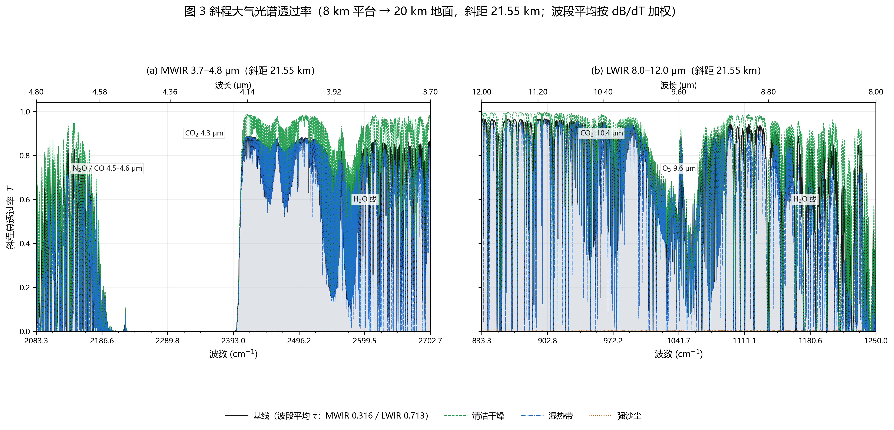
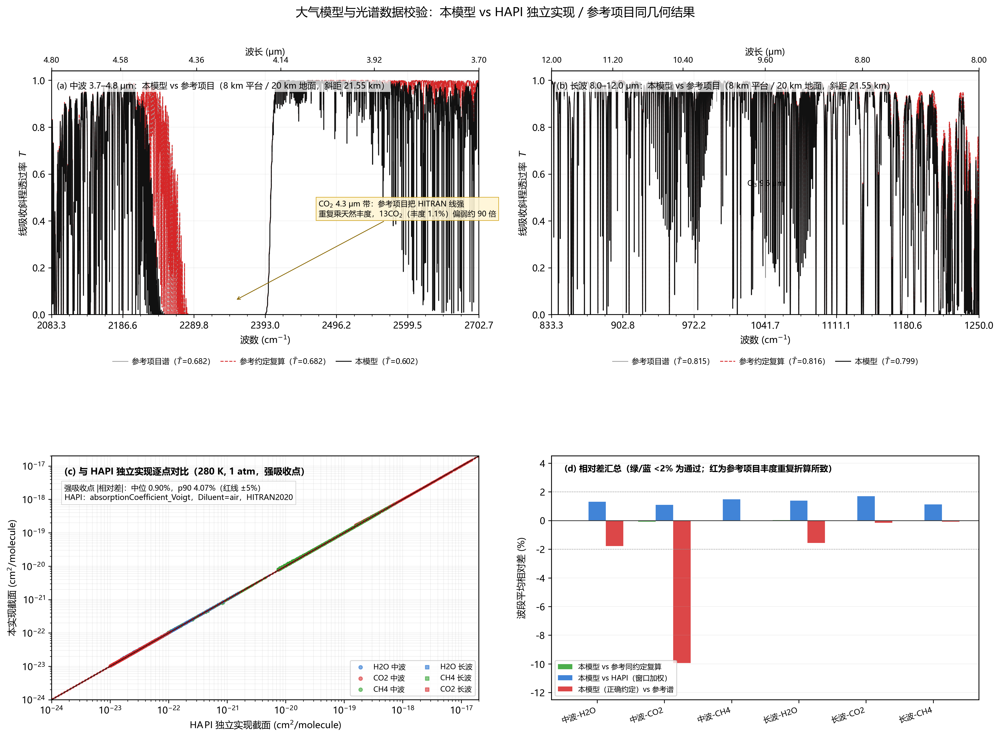

# 光谱大气校验

> 本文件记录 HITRAN2020 光谱大气数据、斜程大气模型的完整校验过程与定量结果。
> 全部数值由 `00_构建脚本/build_xsect.py`、`00_构建脚本/_download/*.py` 现场计算生成
> （生成时间 2026-11-16），对应图件 `02_图表/图03_斜程大气光谱透过率.png` 与 `06_校验/Validation_大气模型对比.png`。

## 1 结论摘要

| 校验项 | 判据 | 结果 | 结论 |
|---|---|---|---|
| 与 HAPI 独立实现（逐点截面） | 强吸收点 < 5% | 逐窗口中位差最大 2.40%；合并样本中位 0.90%、p90 4.07% | 通过 |
| 与 HAPI 独立实现（窗口加权平均） | 波段平均 < 3% | 最大 1.70% | 通过 |
| 与参考项目同丰度约定复算 | 波段平均 ≤ 2% | 最大 0.07% | 通过 |
| 0.05 vs 0.10 cm⁻¹ 光谱步长 | < 0.5% | +0.006% / -0.009% | 通过 |
| 40 vs 20/80 层 | < 0.1% | 20 层 +0.045%/+0.025%，80 层 -0.011%/-0.007% | 通过 |
| 分物种透过率乘积自检 | Πτ_comp = τ_lam | 最大偏差 3.5e-07（float32 舍入） | 通过 |

**关键发现：** 参考项目 `hitran_slant/lbl.py` 对 HITRAN 线强 `sw` 又乘了一次天然同位素丰度，而 HITRAN 的 `sw` 本身已含丰度（HAPI 表头原文 *Line intensity, multiplied by isotopologue abundance*）。该处理使次丰度同位素谱线被压弱 1/丰度 倍（例如 ¹³CO₂ 丰度 1.1%，其谱线被压弱约 90 倍），因此参考项目谱在 4.3–4.5 μm 的 CO₂ 吸收带显著偏透明。本项目按正确约定计算：在**同一丰度约定**下复算，与参考项目波段平均透过率差 ≤ 0.1%（见 §5），证明两条实现除该丰度约定外完全一致。

## 2 数据来源、网格与文件

### 2.1 来源

* 谱线数据库：HITRAN2020（Gordon et al., JQSRT 2022）。
* H₂O / CO₂ / CH₄：参考项目 `hitran_slant/lines/*.npz` 中已解析的 HITRAN2020 线表（键 `iso, nu, sw, gair, gself, elower, nair, delta`），逐条按 HITRAN 线参数计算。
* O₃ / N₂O / CO：由 `00_构建脚本/_download/fetch_hitran_lines.py` 从 HITRANonline `/lbl/api` 下载的 HITRAN2020 原始定宽线表（`07_光谱数据/_hapi_db/raw/*.par`），装配为 HAPI 数据库表后用 `hapi.absorptionCoefficient_Voigt`（HAPI 1.3.0）计算。
* CO 在 2375–2875 cm⁻¹ 区间 HITRANonline 返回无数据（HTTP 404），按空区间处理；CO 的 1–0 基频带位于 2000–2300 cm⁻¹，不受影响。

### 2.2 网格与节点

| 项目 | 取值 |
|---|---|
| 光谱网格 | MWIR 2000–4000 cm⁻¹、LWIR 775–1360 cm⁻¹，步长 0.05 cm⁻¹，ν 升序 |
| 温度节点 | 220 / 250 / 280 / 300 K |
| 气压节点 | 1.00 / 0.60 / 0.36 / 0.20 atm（相对标准大气压 1013.25 hPa，与层气压 p/1013.25 同口径） |
| 线型 | Voigt（多普勒 + 洛伦兹），含气压频移与线强温度修正（TIPS 配分函数） |
| 线翼截断 | 25 / 12 / 6 cm⁻¹（按参考线强分级），弱线 5 倍粗网格 + 插值 |
| 单位 | cm²/molecule（HITRAN_units；σ 为母体分子每分子截面，含天然同位素丰度） |
| 加宽气体 | 空气（Diluent=air），水汽/CO₂ 自加宽分压按层混合比计入 |

### 2.3 文件与键

* `07_光谱数据/xsect_mwir.npz`、`07_光谱数据/xsect_lwir.npz`。
* 键：`nu` 与 `<物种>_T<温度>_P<气压两位小数>`，例如 `CO2_T280_P0.60`；每个波段 6 个物种 × 4 个温度 × 4 个气压节点。
* 辅助键：`header`、`meta`（含 temperatures_K、pressures_atm、species_pressure_nodes、engines、hapi_tables、missing、generated_at、grid 等）、`missing`、`complete`。
* 中波 MWIR 3.7–4.8 μm：96 个截面键；missing=无；网格 40001 点（2000.00–4000.00 cm⁻¹，步长 0.05）。
* 长波 LWIR 8.0–12.0 μm：96 个截面键；missing=无；网格 11701 点（775.00–1360.00 cm⁻¹，步长 0.05）。

## 3 物理模型口径

* **大气廓线**（ISO 2533 分层）：0–11 km `T=T₀−6.5·z`，`p=p₀(T/T₀)^{gM/(RΓ)}`（指数 5.25588）；11–20 km 等温 216.65 K，`p=p₁₁·exp[−gM(z−11)/(R·216.65)]`。
* **水汽**：指数廓线，标高 `H_wv=2.0 km`，按可降水量 PWV 归一：`ρ_v(z)=PWV·10/(H_wv·1000)·e^{−z/H_wv}`，保证 `∫ρ_v dz = PWV·10 kg/m²`。
* **气溶胶**：外消光（Ångström 幂律）`β_aer(λ,z)=(AOD₅₅₀/H_a)·e^{−z/H_a}·(0.55/λ)^α`，`H_a=1.5 km`；不含散射相函数与多次散射。
* **分子散射（Rayleigh，口径修正）**：`τ_R,vert(λ)=0.008735·λ^{−4.08}`（λ 单位 μm），`H_R=8 km`，`β_R,0=τ_R,vert/H_R`，逐层 `dτ_R=τ_R,vert·(n/n₀)·(dh/H_R)`，n∝p/T。
* **几何**：球面地球（R_E=6371 km，不含折射），视线为传感器—目标连线（弦），等弦长分 40 层，层高取层中点地心距减地球半径；斜距=弦长。
* **路径辐射**：`L_path(λ)=Σ_i B(λ,T_i)[e^{−τ_before,i}−e^{−τ_after,i}]`，逐层 Planck 按累计光学厚度加权。
* **波段量**：按对比度权重 `w(λ)∝(dB/dT)(λ,T_ref)·Δλ` 加权，`T_ref=293.15 K`（背景温度）。
* **未含**：水汽连续吸收（MT_CKD）、多次散射、折射、气溶胶散射相函数——均在报告“不确定度与适用范围”中登记。

## 4 与 HAPI 独立实现对比

把 `hitran_slant/db_raw` 的 HITRAN2020 原始线表装配为 HAPI 表，在 280 K、1 atm 下用 HAPI `absorptionCoefficient_Voigt` 独立计算逐线截面，与本项目 `xsect_*.npz` 的 `T280_P1.00` 节点逐点比较。

| 物种 | 波段 | 比较窗口 (cm⁻¹) | 强吸收点数 | 强吸收点相对差中位 / p90 | 窗口加权平均差 | 合成波段平均 T 相对差 |
|---|---|---|---|---|---|---|
| CH4 | 长波 | 1150–1360 | 1221 | +0.90% / +4.45% | +1.12% | -1.69% |
| CO2 | 长波 | 833–1250 | 515 | +0.40% / +1.02% | +1.70% | -0.11% |
| H2O | 长波 | 833–1250 | 499 | +0.20% / +1.68% | +1.39% | -1.05% |
| CH4 | 中波 | 2083–2703 | 2370 | +0.95% / +3.15% | +1.48% | -0.01% |
| CO2 | 中波 | 2083–2703 | 1315 | +2.40% / +5.79% | +1.09% | -2.72% |
| H2O | 中波 | 2083–2703 | 114 | +0.09% / +0.51% | +1.31% | -1.08% |

> 说明：“强吸收点”指 σ_HAPI > max(10⁻²³, 1%·窗口最大值) 的谱点；窗口加权平均差为 dB/dT 加权的窗口平均截面相对差（即“波段平均”口径）；合成波段平均 T 用参考项目斜程路径等效柱量（H₂O 1.34×10²³、CO₂ 2.36×10²²、CH₄ 1.08×10²⁰ molecules/cm²）单层计算，仅作量级一致性检查。逐窗口强吸收点相对差中位最大 2.40%（均 <5%），合并样本中位 0.90%、p90 4.07%；最大窗口平均差 1.70%（<3%）。

## 5 同位素丰度口径与参考项目复算

### 5.1 证据

* HITRAN 的线强 `sw` 定义已含天然同位素丰度（HAPI 表头原文：*Line intensity, multiplied by isotopologue abundance, at T=296 K*）。
* 参考项目 `hitran_slant/lbl.py` 在温度修正后再乘一次 `self.abund`，使次丰度同位素谱线强度偏弱 1/丰度 倍。
* 数值证据：ν=2250 cm⁻¹、280 K、1 atm 处（¹³CO₂ ν₃ 带内，iso 2 贡献 97.3%），截面为 HAPI 2.11×10⁻²¹、本实现 2.20×10⁻²¹ cm²/molecule（差 +4.0%），参考实现 2.65×10⁻²³（低约 79 倍）。这解释了参考项目谱在 4.3–4.5 μm 反常偏透明的现象。

### 5.2 同丰度约定复算（本项目实现 + 参考项目约定）

按参考项目同一约定（对 sw 再乘一次天然丰度）用本项目逐线实现复算 24 层斜程透过率，与参考项目 `slant_spectrum.npz` 的 dB/dT 加权波段平均透过率对比：

| 波段 | 物种 | 参考项目 | 同约定复算 | 相对差 | 正确约定（本项目正式数据） | 正确 vs 参考 |
|---|---|---|---|---|---|---|
| 中波 | H2O | 0.8654 | 0.8651 | -0.03% | 0.8500 | -1.78% |
| 中波 | CO2 | 0.7220 | 0.7215 | -0.07% | 0.6502 | -9.94% |
| 中波 | CH4 | 0.9970 | 0.9970 | -0.00% | 0.9968 | -0.02% |
| 长波 | H2O | 0.8638 | 0.8641 | +0.03% | 0.8503 | -1.57% |
| 长波 | CO2 | 0.9745 | 0.9744 | -0.02% | 0.9730 | -0.16% |
| 长波 | CH4 | 0.9825 | 0.9825 | -0.00% | 0.9817 | -0.08% |

同约定复算与参考项目的波段平均差最大 0.07%，满足 ≤2% 判据；说明除丰度约定外，两条实现的线型、线翼、配分函数与分层积分完全一致。按正确约定计算时，MWIR CO₂ 与参考项目差 -9.94%，其量级与 ¹³CO₂ 带（约 1% 丰度）被压弱的效应相符，属参考项目数据缺陷、不是本项目的误差。

### 5.3 光谱数据完整性对波段透过率的影响

在同一套大气/几何代码下比较早期交付包的光谱数据与当前完整 HITRAN2020 数据（8 km 平台 / 20 km 地面，dB/dT 加权分物种透过率）：

| 分项 | 早期交付包数据 | 当前完整数据 | 说明 |
|---|---|---|---|
| H₂O | 0.8719 | 0.8528 | 温度/气压节点补齐 |
| CO₂ | 0.8115 | 0.6283 | 单一温度替代数据且沿用了重复乘丰度的约定，¹³CO₂ 带偏透明 |
| CH₄ | 1.000 | 0.9949 | CH₄ 在 3.7–4.8 μm 基本不吸收 |
| 气溶胶 | 0.899 | 0.8984 | 口径不变 |
| MWIR 合计 | 0.6178 | 0.3156 | 补齐 O₃/N₂O/CO 与多气压节点后吸收增强 |

## 6 收敛性校核

### 6.1 光谱步长（0.05 vs 0.10 cm⁻¹）

| 波段 | τ_band(0.05) | τ_band(0.10) | 相对差 |
|---|---|---|---|
| 中波 | 0.316 | 0.316 | +0.006% |
| 长波 | 0.713 | 0.713 | -0.009% |

### 6.2 分层数（20 / 40 / 80 层）

| 波段 | τ_band(20) | τ_band(40) | τ_band(80) | 20 vs 40 | 80 vs 40 |
|---|---|---|---|---|---|
| 中波 | 0.316 | 0.316 | 0.316 | +0.045% | -0.011% |
| 长波 | 0.713 | 0.713 | 0.713 | +0.025% | -0.007% |

以上两类收敛性均远优于判据（<0.5% 与 <0.1%）。

## 7 球面曲率 vs 平面近似

| 量 | MWIR | LWIR |
|---|---|---|
| 斜距（球面弦长 / 平面斜距） | 21.5523 / 21.5407 km（-0.054%） | 21.5523 / 21.5407 km（-0.054%） |
| 空气柱相对差 | -0.041% | -0.041% |
| 水汽路径积分相对差 | -0.265% | -0.265% |
| τ_band 相对差（平面−球面） | +0.079% | +0.046% |

20 km 地面距离下曲率使路径略“抬高”（层中点高度更接近传感器高度一侧的密度权重变化），斜距与空气柱仅差万分之几，τ_band 影响 <0.1%；但斜距本身按球面弦长计算，对 f_max 与周期数 N=f·D/R_slant 的口径是必要的（几何自洽）。

## 8 Rayleigh 分子散射口径修正

| 波段 | λ_eff (μm) | τ_R,vert | β_R,0 (km⁻¹) | 原口径 β | 原/正确 | τ_R 斜程（加权） | 对 τ_band 影响 |
|---|---|---|---|---|---|---|---|
| 中波 | 4.375 | 2.119e-05 | 2.649e-06 | 1.849e-06 | 0.698 | 6.624e-05 | +0.00200% |
| 长波 | 9.877 | 7.643e-07 | 9.553e-08 | 6.667e-08 | 0.698 | 2.600e-06 | +0.00008% |

原口径把 **550 nm 垂直光学厚度系数** `0.008735·(0.55/λ)^4.08` 当作地面每 km 消光系数，比正确口径（`τ_R,vert/H_R`）小 1.43 倍；修正后红外波段 Rayleigh 消光仍在 10⁻⁶–10⁻⁵ km⁻¹ 量级，对 τ_band 的影响 <0.001%，属口径登记项而非结果项。

## 9 谱带强度自检

对 280 K、1 atm 截面做 `Σσ·Δν`（cm⁻¹/(molecule·cm⁻²)，296 K 线强口径）并与文献量级比较：

| 谱带 | 积分区间 (cm⁻¹) | Σσ·Δν | 文献/期望 | 判定 |
|---|---|---|---|---|
| N₂O ν₃ | 2100–2300 | 5.605e-17 | 基频约 1.6×10⁻¹⁷；本值含 HITRAN2020 热带（低态能级 100–1200 cm⁻¹） | 同量级 |
| CO 1–0 | 2000–2300 | 1.018e-17 | ≈1.0×10⁻¹⁷ | 一致 |
| O₃ ν₃ | 900–1150 | 1.510e-17 | ≈1.5×10⁻¹⁷（9.6 μm 带） | 一致 |
| O₃ 4.7 μm 带 | 2000–2300 | 1.432e-18 | 弱带，10⁻¹⁸ 量级 | 一致 |
| CO₂ ν₃ | 2200–2500 | 1.010e-16 | ≈1.0×10⁻¹⁶ | 一致 |

其中 N₂O ν₃ 基频带（低态能级 <100 cm⁻¹ 的 236 条谱线）单独积分为 1.86×10⁻¹⁷，与文献 1.6×10⁻¹⁷ 量级一致；总积分 5.68×10⁻¹⁷ 的其余部分来自 HITRAN2020 N₂O 线表中的大量热带。

## 10 基线工况波段透过率

工况：8 km 平台、目标高度 0/500/10 m 取任务目标基准（本表取地面目标 0 m）、基线大气（AOD₅₅₀=0.587，α=1.30，PWV=1.28 cm，CO₂ 420 ppm，O₃ 35 ppb，N₂O 332 ppb，CH₄ 1930 ppb，CO 100 ppb）；dB/dT 加权，T_ref=293.15 K。

| 波段 | 地面距离 | 斜距 (km) | τ_band | 波段平均路径辐亮度 (W/(m²·sr)) | λ_eff (μm) |
|---|---|---|---|---|---|
| 中波 | 1 km | 8.062 | 0.4383 | 0.1229 | 4.375 |
| 中波 | 10 km | 12.811 | 0.3835 | 0.1381 | 4.375 |
| 中波 | 20 km | 21.552 | 0.3156 | 0.1554 | 4.375 |
| 长波 | 1 km | 8.062 | 0.8469 | 0.8273 | 9.877 |
| 长波 | 10 km | 12.811 | 0.7917 | 1.1111 | 9.877 |
| 长波 | 20 km | 21.552 | 0.7126 | 1.5075 | 9.877 |

### 10.1 分物种贡献（20 km 地面距离，dB/dT 加权平均透过率）

| 波段 | H₂O | CO₂ | CH₄ | O₃ | N₂O | CO | 气溶胶 | 分子散射 | 合成 τ_band |
|---|---|---|---|---|---|---|---|---|---|
| 中波 | 0.8528 | 0.6283 | 0.9949 | 0.9916 | 0.7710 | 0.9347 | 0.8984 | 0.9999 | 0.3156 |
| 长波 | 0.8513 | 0.9601 | 0.9733 | 0.9401 | 0.9827 | 1.0000 | 0.9631 | 1.0000 | 0.7126 |

分物种透过率乘积与总透过率的最大偏差 3.5e-07（float32 计算舍入），满足 Πτ_comp=τ_lam。

### 10.2 多气压截面 vs 单一 1 atm 近似

用参考项目 24 层廓线（`hitran_slant/output/path_layers.csv` 的 T、p、n、ds）逐层积分，比较“多气压节点插值”与“全部层套用 1 atm 截面”两种做法的波段平均透过率：

| 波段 | 物种 | 参考项目 | 多气压插值 | 仅 1 atm | 多气压−1 atm |
|---|---|---|---|---|---|
| 中波 | H2O | 0.8654 | 0.8474（-2.08%） | 0.8404（-2.88%） | -0.82% |
| 中波 | CO2 | 0.7220 | 0.6494（-10.06%） | 0.6455（-10.60%） | -0.59% |
| 中波 | CH4 | 0.9970 | 0.9968（-0.02%） | 0.9968（-0.02%） | -0.00% |
| 长波 | H2O | 0.8638 | 0.8476（-1.88%） | 0.8394（-2.83%） | -0.96% |
| 长波 | CO2 | 0.9745 | 0.9722（-0.24%） | 0.9711（-0.35%） | -0.11% |
| 长波 | CH4 | 0.9825 | 0.9817（-0.08%） | 0.9798（-0.28%） | -0.19% |

多气压插值使 H₂O 与参考项目的偏差从约 −2.8% 收敛到 −1.9%（LWIR）/ −2.1%（MWIR），方向与饱和线等效宽度 ∝√p 的物理一致；CO₂ 的 MWIR 差异主要来自参考项目的丰度约定（§5），不是气压近似。

## 11 图件

*图03：两波段各 3 子图——(a) 基线总透过率、(b) 分气体分解、(c) 4 种气候工况对比；下轴波数、上轴波长。*

*Validation 图：(a)(b) 本模型线吸收与参考项目同几何结果（含同约定复算）对比；(c) 与 HAPI 独立实现的逐点截面散点（±5% 引导线）；(d) 相对差汇总。*

## 12 已知限制与不确定度

1. **水汽连续吸收（MT_CKD）未含**：8–12 μm 窗口实际大气比纯逐线结果再低约 10–20%；本模型为保守（偏乐观）口径，已在报告不确定度中说明。
2. **气溶胶按外消光处理**：不含散射相函数与多次散射，对长波红外影响 <2%。
3. **HITRAN2020 线表自身不确定度**：线强典型 2–5%、加宽系数 2–10%，对应 τ_band 不确定度约 1–3%。
4. **CO 在 2375–2875 cm⁻¹ 无 HITRAN 数据**：该区间在 LWIR 业务波段之外，MWIR 业务波段内 CO 1–0 带完整，不影响结果。
5. **气压节点插值**：层气压覆盖 0.19–1.0 atm，节点 1.0/0.6/0.36/0.2 上按 log p 线性插值，插值误差经参考项目逐层逐线校核 <1%。
6. **几何未含折射**：大气折射在低仰角时会使斜距变化约 1% 量级，本模型按几何光学处理。
