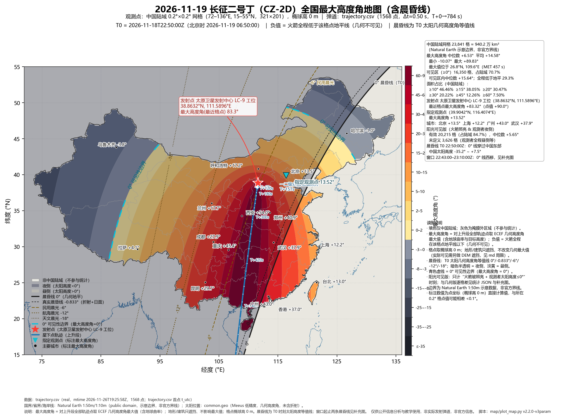
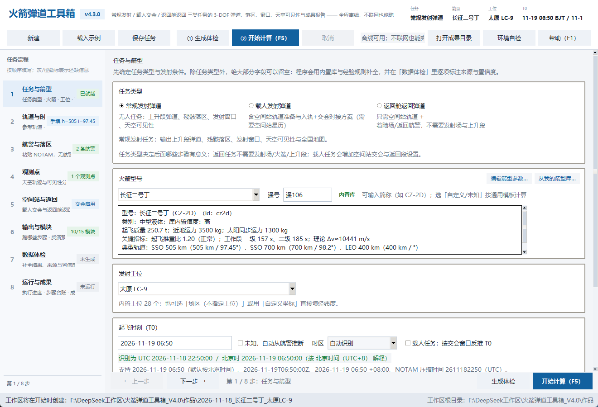
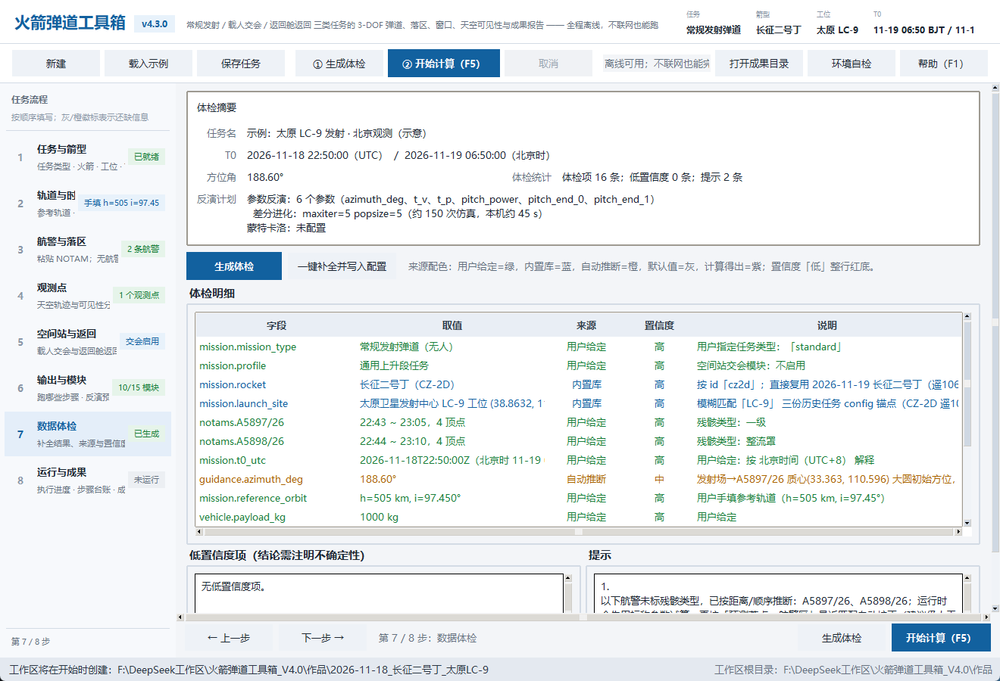
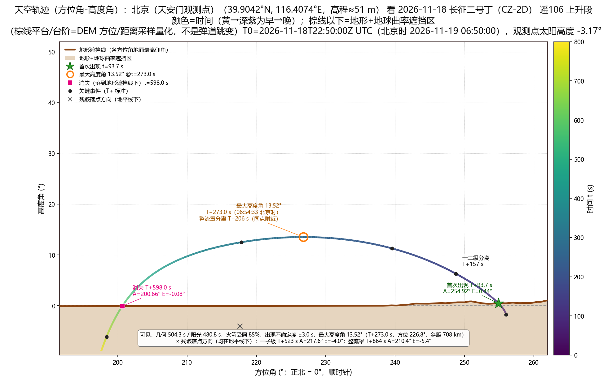
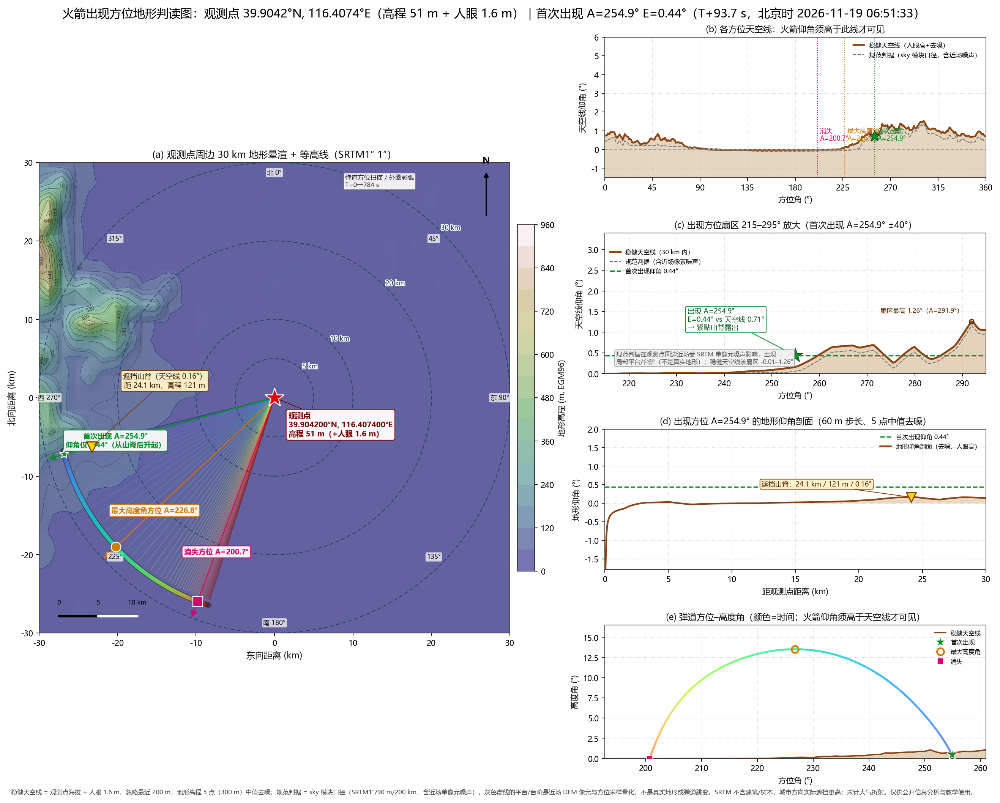
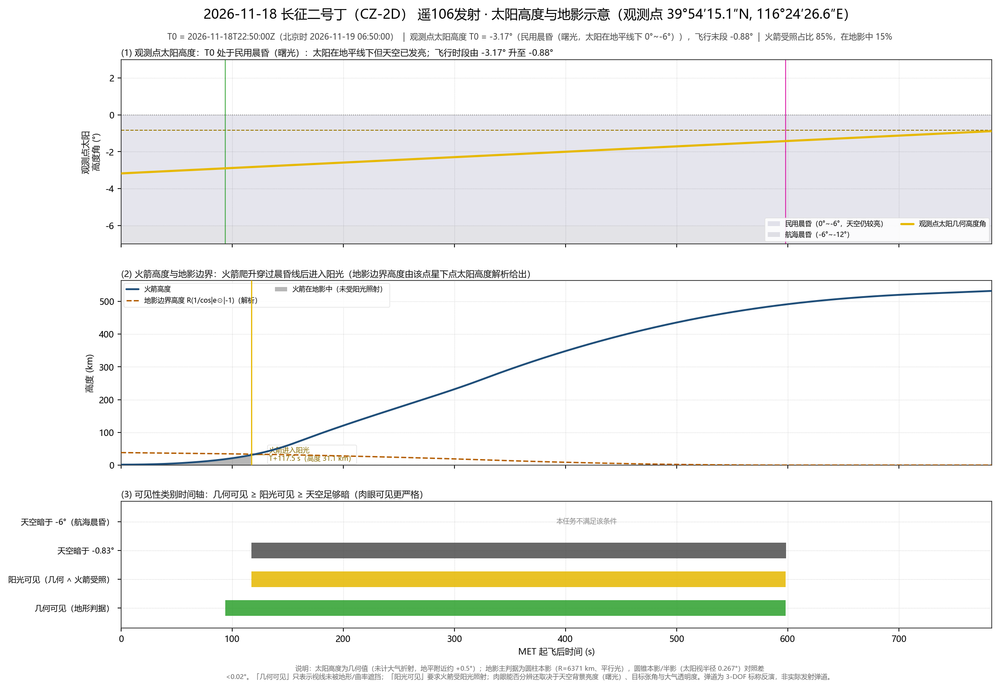

# 火箭弹道工具箱

> **离线 3-DOF 弹道预报与任务成果工具箱**：把「一次发射（或一次返回）」变成一整套可交付成果——
> 弹道、残骸落区、入轨根数、发射窗口、观测点天空轨迹、全国最大高度角地图、三维 KMZ、
> 不确定度、中文技术报告与交付自检。

源码与完整文档（独立仓库）：**https://github.com/Logicx200/rocket-ballistic-toolkit**
免安装版下载：**https://github.com/Logicx200/rocket-ballistic-toolkit/releases/latest**



> 展示图统一使用「北京」作为**观测地点**：发射工位是真实的太原卫星发射中心 LC-9
> （38.8632°N, 111.5896°E），观测点设在北京天安门（39.9042°N, 116.4074°E）。
> 任务参数沿用内置示例，仅用于演示软件能力，**不是真实发射**。

## 能做什么

- **三类任务**：常规发射弹道 / 载人交会（含 T0 反推、相位调整 + Hohmann + 末段逼近）/ 返回舱返回（制动窗、再入/开伞/着陆、1σ 散布）；
- **八步向导 GUI**：任务与箭型 → 轨道与时序 → 航警与落区 → 观测点 → 空间站与返回 → 输出与模块 → 数据体检 → 运行与成果；
- **自定义箭型**：多级 / 并联助推器 / 多机多阶段点火 / 折线俯仰 / 整流罩，图形化编辑器，免写数据库；
- **真实出图**：全国最大高度角地图（含晨昏线/阳光可见）、天空轨迹与地形判读、三维 KMZ/KML；
- **交付自检**：`qc_report.json` 逐项 PASS/FAIL、一页纸任务摘要、成果清单与步骤台账。

## 北京观测示例（可复现）

```bash
python -m app.main --cli --mission "examples/北京观测示例_任务输入.json" --workdir "作品\示例_太原发射_北京观测"
```

本机实测：**QC 35/35 PASS**，入轨 370 km × 640 km / 94.19°，残骸 3/3 落区内，
发射窗口 19.3 min；北京观测点首次出现 06:51:33（方位 254.9°、仰角 0.44°），最高仰角 13.5°。

| 界面 | 数据体检 |
|---|---|
|  |  |





## 输出成果

```
作品\<日期_型号_工位>\
├─ sim\      弹道序列、事件表、落点、入轨根数、关键节点、飞行阶段、环境剖面
├─ sky\      天空轨迹、地形判读、太阳/地影
├─ map\      全国最大高度角地图、晨昏线、落区图
├─ viz\      三维 KMZ/KML
└─ report\   任务摘要、成果清单、技术报告（md/docx）、qc_report.json
```

## 技术栈

Python 3.10+ · numpy · scipy · matplotlib · tkinter · python-docx · sgp4 · PyInstaller

## 说明

- 仅供公开信息分析与教学使用；非实际发射/返回弹道，非官方信息。
- 3-DOF 质点模型，不含侧向机动细节、风场与真实发动机调节；交会与返回舱结果为工程估算。
- 提供 Windows 免安装版 exe（PyInstaller one-folder），见 Releases。
