# 复杂大气环境红外目标探测仿真——Python 侧仿真结果报告（v1.0）

> 运行环境：Python 3.11 / numpy / scipy / matplotlib；一次完整运行约 20 s。
> 代码：`run_sim.py` + `irsim/`；数据：`sim_results/data/*.csv`；图：`sim_results/figures/*.png`。
> **重要说明**：本报告基于简化物理模型（非逐线/带模型），结论用于**方法验证、趋势判断与临界边界设计**，绝对作用距离需用 COSSIM/libRadtran 复核（见第 10 节）。

---

## 1. 摘要

在参考系统（100 mm 口径、f=250 mm、F/2.5、15 μm 像元、IFOV=0.06 mrad、NETD=30 mK）与目标（等效尺寸 2.3 m、ΔT=10 K）下，得到：

| 结论 | 数值 |
|---|---|
| 识别任务（N50=8）基准 R50 | **2.62 km**（R90=0.89 km） |
| 识别距离的物理上限（衍射极限） | **2.87 km** → 识别距离由口径/波段决定，大气只在雾/雨时显著 |
| 探测任务（N50=2）基准距离 Rdet | **9.66 km** |
| 浓雾（MOR=0.8 km, α=0） | Rdet **0.95 km**（−90%），R50 0.84 km |
| 雨等效（MOR=8 km, α=0） | Rdet **5.64 km**（−42%） |
| 强湍流（Cn²=1e-13） | Rdet **6.43 km**（−33%），R50 2.25 km |
| 沙尘 + MWIR（MOR=4, α=0.3） | Rdet **4.73 km**，R50 2.65 km |
| MWIR 基准 | Rdet 8.22 km（比 LWIR 短 15%），R50 3.20 km（比 LWIR 长 22%） |
| 主导大气参数（LWIR 探测距离 Sobol ST） | α **0.60**、MOR **0.46**、Cn² 0.10、w 0.01、ΔT 0.02 |

此外还生成了 **4 张天气因子两两组合热力图（图 8–11）**：把 MOR、α、w、Cn² 两两组合成 6 个切片，用于展示任意两个天气参数共同作用下的性能边界（见 5.4 节）。

三条核心发现：

1. **识别距离被衍射极限“锁死”**：100 mm 口径、8 μm–12 μm 下识别 2.3 m 目标的物理上限约 2.87 km，基准 R50=2.62 km 已接近该上限；复杂大气对识别距离的影响主要发生在 MOR<1 km 的雾/雨，其余天气下差异在 0.5 km 以内。
2. **探测距离才是“复杂大气”的主战场**：同一系统探测距离 9.66 km，浓雾降到 0.95 km、雨降到 5.64 km、强湍流降到 6.43 km；相图与临界曲线（第 6 节）都建立在这个任务上。
3. **LWIR 对霾“免疫”、对灰消光“致命”**：同样 MOR=2 km，α=0（雾/雨灰消光）时 Rdet=2.27 km，α=1.3（霾）时 Rdet=9.33 km，相差 4.1 倍；MWIR 对 MOR/α 更敏感（沙尘 MWIR 的 Rdet 4.73 km 仅为基准的 49%）。

---

## 2. 模型与方法

### 2.1 链路

```
大气状态 (MOR, α, w, Cn²)
   │
   ├─► 消光谱 β(λ) = β_aer(λ) + β_H2O(λ) + β_CO2(λ)  ──► τ_band（波段加权）
   │
   ├─► 视在温差 ΔT_app = τ_band · ΔT
   │
   ├─► 传感器 MTF 链：衍射 · 像元 sinc · 湍流 · 抖动 · 电子学
   │        └─► MRTD(f) = k·NETD / MTF_sys(f)
   │
   ├─► 由 MRTD(f)=ΔT_app 求最高可分辨频率 f_max
   │
   ├─► N = f_max · θ_target（θ = 目标尺寸/距离）
   │
   └─► P_d(N) = (N/N50)^E / [1+(N/N50)^E] ──► R50 / R90（求根）与 Rdet
```

### 2.2 关键参数

| 项目 | 取值 | 说明 |
|---|---|---|
| 口径/焦距/F# | 100 mm / 250 mm / **F2.5** | 设计文档基线写 F#=2.0 与 f/D 不符，本报告按实际 2.5 计算，需统一 |
| 像元/IFOV | 15 μm / 0.06 mrad | p/f |
| NETD | 30 mK | 制冷型假设 |
| 目标 | 2.3 m，ΔT=10 K（低对比 3 K） | 等效临界尺寸 |
| N50 | 识别 8.0；探测 2.0 | Johnson/NVThermIP 经验值，须绑定来源 |
| TTPF 指数 E | 2.0 | 需按数据集标定 |
| MRTD 系数 k | 2.5 | MRTD(0)=2.5·NETD，需实测标定 |
| 湍流 | Cn² 1e-16–1e-13，r0=0.185λ^{6/5}(Cn²L)^{-3/5} | Fried 1966；ITU-R P.1817 |
| 大气 | β_aer=3.912/MOR·(0.55/λ)^α；水汽/CO2 参数化 | Koschmieder、Ångström、OPAC/HITRAN 简化 |

### 2.3 假设与局限（必须在正式报告中声明）

1. **大气是非逐线参数化模型**：水汽连续吸收与 CO2 4.3 μm 带用标定系数近似，未含 O₃/N₂O/CH₄、多次散射、气溶胶散射相函数与 veiling 光；正式版由 libRadtran/MODTRAN 提供 τ(λ)、L_path(λ)。
2. **水平均匀、局地热平衡**；未含斜程、云、温度廓线、逆温。
3. **MRTD 为工程近似**（k·NETD/MTF），未含 3D 噪声（光子/读出/1/f/FPN）、NUC、人眼 CTF 与 TTP 链；MRTD 系数 k 与 TTPF 指数 E 未用实测数据标定。
4. **目标为均匀面源**，无纹理、无运动模糊；识别判据基于周期数 N，未做图像级观察者实验。
5. 因此：**趋势、相对量级、临界边界可信；绝对距离需 COSSIM 锚点校验**。

### 2.4 自检（V1 层）

| 检查 | 结果 |
|---|---|
| 透过率极限：MOR=1000 km、w=0.01 cm | τ_band=0.9984 → 合理 |
| P_d(R) 随距离单调下降 | 图 4 通过 |
| R50 求根区间与单调性 | 全部 24 个确定性工况收敛 |
| 与衍射极限一致 | R50=2.62 km vs 上限 2.87 km，自洽 |
| GP 代理模型 5 折 CV R² | 0.992–0.999 |

---

## 3. 确定性工况结果

完整表见 `data/cases_metrics.csv`，关键工况：

| 工况 | 波段 | τ_band | ΔT_app (K) | N（@4 km） | P_d@4 km | R50 (km) | Rdet (km) |
|---|---|---|---|---|---|---|---|
| A0 基准 | LWIR | 0.816 | 8.16 | 5.17 | 0.294 | 2.62 | **9.66** |
| B3 中等霾 MOR=5 | LWIR | 0.769 | 7.69 | 5.15 | 0.293 | 2.61 | 9.55 |
| B10 w=0.5 cm | LWIR | 0.924 | 9.24 | 5.21 | 0.298 | 2.63 | 9.89 |
| B12 w=5 cm | LWIR | 0.531 | 5.31 | 5.00 | 0.281 | 2.57 | 8.83 |
| B15 强湍流 Cn²=1e-13 | LWIR | 0.816 | 8.16 | 3.86 | 0.189 | 2.25 | 6.43 |
| B16 低对比 ΔT=3 K | LWIR | 0.816 | 2.45 | 4.62 | 0.250 | 2.37 | 8.52 |
| B17 MWIR 基准 | MWIR | 0.179 | 1.79 | 6.02 | 0.361 | 3.20 | 8.22 |
| C1 浓雾 MOR=0.8 | LWIR | ≈0 | ≈0 | 0 | 0 | 0.84 | 0.95 |
| C3 沙尘+MWIR | MWIR | 0.026 | 0.26 | 3.53 | 0.163 | 2.65 | 4.73 |
| C4 雨等效 MOR=8, α=0 | LWIR | 0.086 | 0.86 | 3.90 | 0.192 | 2.34 | 5.64 |
| C5 晴空+强湍流 | LWIR | 0.816 | 8.16 | 3.86 | 0.189 | 2.25 | 6.43 |
| C6 干冷 ΔT=3 K | LWIR | 0.872 | 2.62 | 4.85 | 0.269 | 2.44 | 9.49 |

**读表结论**

- R50 几乎不随 MOR/α 变化（2.25–2.66 km），因为识别距离接近衍射极限（2.87 km），大气再差也只是把上限往下压一点；
- Rdet 对大气敏感：浓雾 −90%、雨 −42%、强湍流 −33%、沙尘 MWIR −51%、MWIR 基准 −15%；
- 水汽 w 从 0.5→5 cm，Rdet 9.89→8.83 km（−10.7%）；低对比 ΔT=3 K 使 Rdet −11.8%。

---

## 4. 波段透过率谱

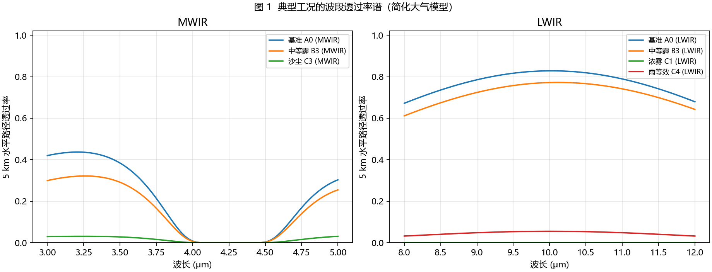

- MWIR：CO2 4.3 μm 带在 3.9–4.55 μm 形成深谷；沙尘（MOR=4, α=0.3）使 3–5 μm 整体透过率降到 ~0.03；
- LWIR：8–12 μm 窗区在基准下 5 km 平均透过率 0.82，水汽使边缘（8.0、12.0 μm）下降更快；
- 灰消光（雾、雨、α→0）在 LWIR 依然致命：C1 浓雾 5 km 透过率≈0，而同等 MOR 的霾（α=1.3）仍有约 0.77。

---

## 5. 参数相图

**LWIR 探测距离相图**（w=1.5 cm, Cn²=1e-14, ΔT=10 K）：

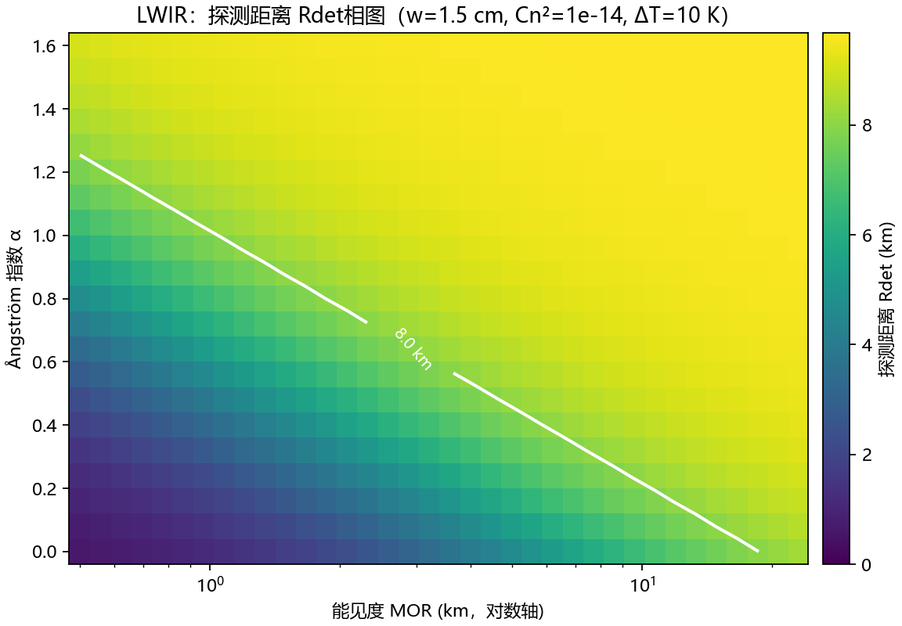

**MWIR 探测距离相图**（同参数）：

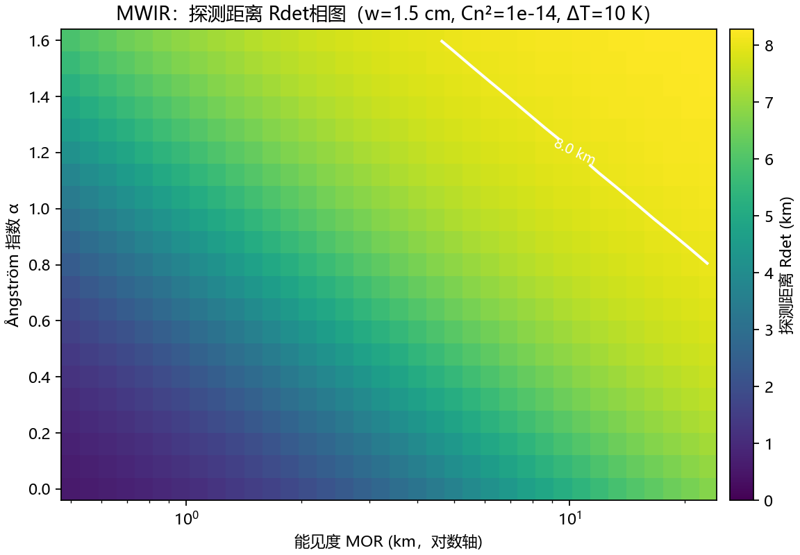

读图要点：

1. 白色 8 km 等值线把相图分成"满足/不满足"两区；LWIR 的等值线在 α≈0 时延伸到 MOR≈19 km，α=1.3 时收缩到 MOR≈0.44 km；MWIR 的等值线整体左移，说明对同一天气更敏感；
2. **同 MOR 不同 α 的差异极大**：MOR=2 km 时，LWIR 在 α=0→2.27 km、α=1.3→9.33 km（4.1 倍）；这就是"只用一个能见度参数不够"的直接证据；
3. 相图右上角（大 MOR、大 α）为"性能饱和区"，此时限制来自衍射/MTF 而非大气；左下角为"大气失效区"。

**识别距离相图**（LWIR，N50=8）：

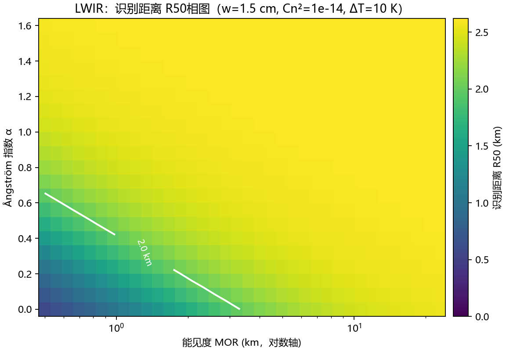

识别距离在绝大多数 (MOR, α) 上处于 2.6 km 的平台（黄色），仅在浓雾/灰消光角落塌缩——与"识别受衍射极限约束"的结论一致。

### 5.4 天气因子两两组合热力图（图 8–11）

把四个天气参数（MOR、α、w、Cn²）两两组合成 6 个二维切片；未在坐标轴上的参数取标称值（MOR=5 km、α=1.3、w=1.5 cm、Cn²=1e-14、ΔT=10 K）。颜色为探测距离 Rdet，白线为 4/6/8 km 等值线。

**图 8 LWIR 六个两两组合面板**：

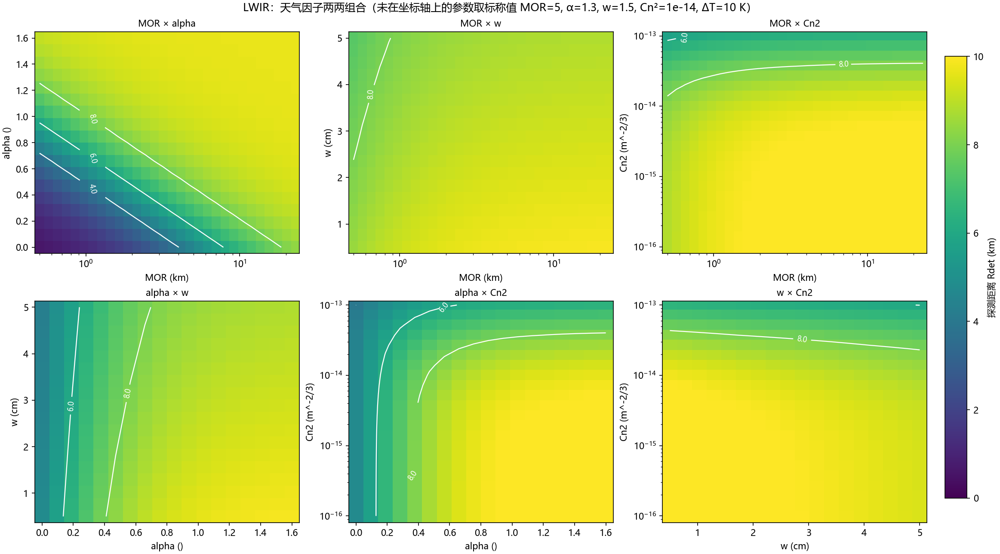

**图 9 MWIR 六个两两组合面板**：

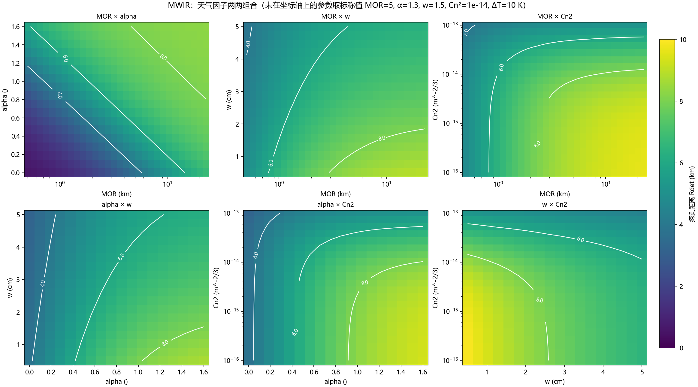

**图 10 LWIR 识别距离矩阵**：

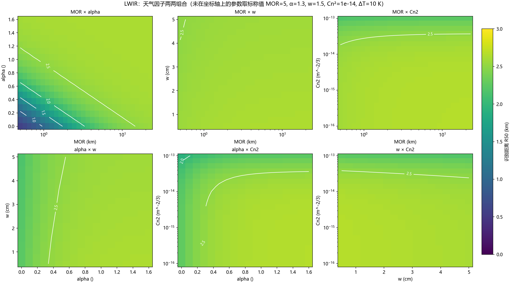

**图 11 波段对比（MOR × α）**：

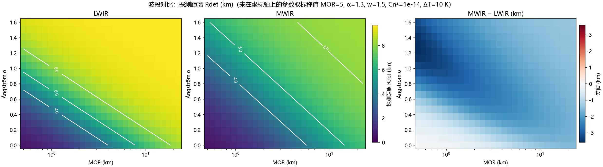

逐面板读图要点：

1. **MOR×α**：等值线沿对角带分布；α 从 1.3 降到 0，维持 8 km 所需的 MOR 从 0.44 km 抬升到 19 km——α 是"同一能见度下性能差异"的总开关；MWIR 等值线整体左下移，对 MOR/α 更敏感。
2. **MOR×w**：水汽单独作用弱，8 km 线仅在 MOR<1 且 w>4 cm 时略上翘，与 Sobol 中 w 的 ST≈0.01 一致。
3. **MOR×Cn²**：8 km 线在 Cn²≈2e-14 附近近似水平，说明**湍流容限基本由 Cn² 单独决定**；强湍流（>5e-14）时等值线略弯，二者弱叠加。
4. **α×w、α×Cn²**：形状与 MOR×α 类似（α 主导）；α 低时对 w/Cn² 更敏感。
5. **w×Cn²**：8 km 线呈对角，水汽与湍流存在弱补偿（w 大→吸收强→可容忍 Cn² 略低）。
6. **识别矩阵（图 10）**：几乎全部处于 2.5 km 平台，仅左下角（α<0.2 且 MOR<1）塌缩——识别任务由衍射极限主导，天气只在极端条件起作用。
7. **波段差（图 11）**：MWIR−LWIR 在大部分区域为负（MWIR 探测距离更短，最多约 −4 km）；在 α≈0 且 MOR 低时两者都失效、差值趋于 0。LWIR 适合远距探测，MWIR 因衍射极限小更适合识别（R50：3.20 vs 2.62 km）。

> 注意：热力图是二维切片，固定值改变时等值线会移动；正式报告建议附 2–3 个固定值切片（基准/最不利）并用临界值法（实验设计方案 5.9 节）校核。

---

## 6. 等性能边界（临界曲线）

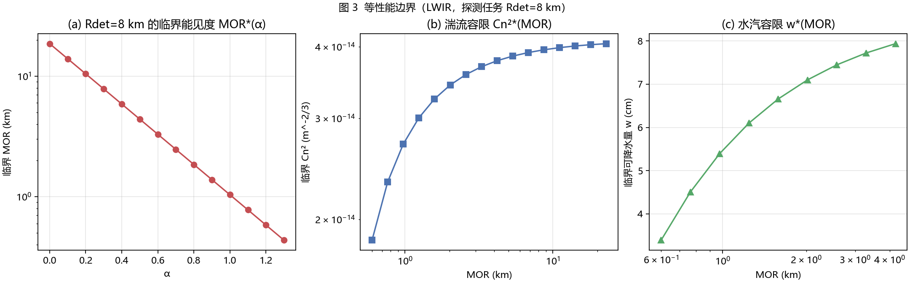

以"探测任务 Rdet=8 km"为阈值：

| 曲线 | 结果 |
|---|---|
| 临界能见度 MOR*(α) | α=0 时 **18.6 km**；α=0.2 时 10.4 km；α=1.0 时 1.04 km；α=1.3 时 **0.44 km** |
| 湍流容限 Cn²*(MOR) | 1.84e-14（MOR=0.6）→ 4.05e-14（MOR=23），随能见度提高而放宽 |
| 水汽容限 w*(MOR) | 3.39 cm（MOR=0.6）→ 7.94 cm（MOR=4.2）；MOR>4 时 w≤8 cm 不再构成限制 |

使用方式：给定天气（MOR, α），查 MOR*(α) 判断是否满足 8 km 探测；若 MOR 不足，查 Cn²*(MOR) 得到允许的湍流上限；LWIR 下水汽通常不是限制项（与 Sobol 结果一致）。

> 说明：α>1.3 时 MOR*(α) 落出搜索区间（0.4 km 以下），表示该天气下 8 km 探测仍可满足；这是等性能分析的"饱和"表现，报告时应标注搜索范围。

---

## 7. 探测概率曲线

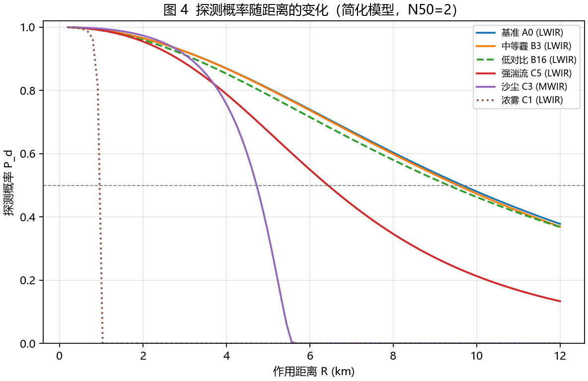

- 基准 A0 与中等霾 B3 的 P_d(R) 曲线几乎重合（LWIR 对霾不敏感），P_d=0.5 在 9.5–9.7 km；
- 强湍流 C5（红）与雨等效 C4（绿）在 6–8 km 明显下压；
- 浓雾 C1（点线）在 1 km 内即跌破 0.5；
- 沙尘 MWIR C3（紫）在 3–5 km 快速下降，是"波段选择"最典型的反例。

---

## 8. 全局敏感性（Morris + Sobol）

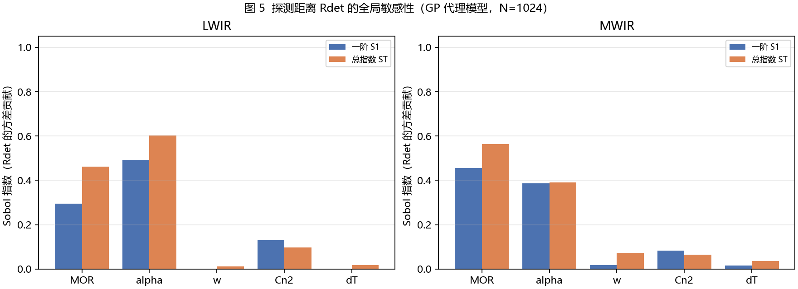

- 代理模型：每个波段 150 点 LHS + GP（RBF 核，逐维长度尺度最大化边际似然），5 折 CV R²≥0.99；
- LWIR 探测距离：α（ST=0.60）> MOR（0.46）>> Cn²（0.10）> ΔT（0.02）> w（0.01）；
- MWIR 探测距离：MOR（0.56）> α（0.39）> w（0.07）≈ Cn²（0.07）> ΔT（0.04）。

**重要提醒**：LWIR 中 α 与 MOR 的 ST 之和为 1.07（MWIR 为 0.95），且两者一阶指数都显著——这说明 **MOR 与 α 在单波段内高度共线**（β(λ) ≈ β₅₅₀·(0.55/λ)^α，在 λ_eff 附近二者近似可互换）。因此：

- 单波段数据**无法唯一分离**"能见度"和"气溶胶类型"的贡献；
- 要解耦，需多波段/光谱信息（如 MWIR+LWIR 联立）或固定 β(λ_eff) 做条件敏感性分析；
- 报告里不能把 MOR 与 α 的主效应当成独立结论，必须说明共线性。

---

## 9. 湍流的影响

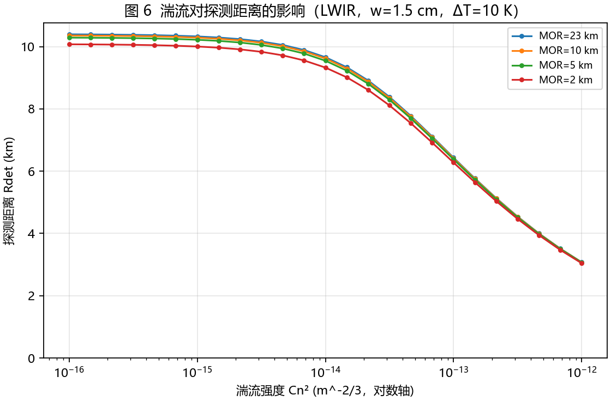

- Cn² 从 1e-16 增到 1e-12，Rdet 从约 10.3 km 单调降到 3.0 km；
- 拐点在 Cn²≈1e-14：更强的湍流使 MTF 在低中频就下降，探测距离快速损失；
- 在弱湍流端（Cn²≤1e-15）Rdet 饱和于 10.3 km，说明此时限制来自口径/衍射与大气吸收，而不是湍流。

---

## 10. 讨论

### 10.1 为什么"复杂大气"在本系统上体现为探测任务而非识别任务？

识别要求 N=8 个周期跨过目标，几何关系要求 R ≤ D·Dₜ/(N·λ) = 0.1×2.3/(8×10⁻⁵) ≈ 2.87 km（衍射极限）。在 2.6 km 附近，即使 MOR=2 km 的霾，τ 仍有约 0.89，大气损失不足以显著改变识别距离；只有雾/雨（α≈0）才会把 τ 压到 0.1 以下。而探测只需 N=2，作用距离推到 9–10 km，此时大气累积衰减、湍流 MTF、水汽/CO2 吸收都开始起作用——所以**"复杂大气"的敏感性随任务难度（N50）和距离增加而放大**。

### 10.2 对方案设计的启示

1. **任务定义决定大气参数的重要性**：识别任务下 Sobol 的 α/MOR 贡献主要来自低 MOR 角落；探测任务下它们是全局主导。报告应分别给出两类任务的结论。
2. **MOR–α 共线**：单波段内不可分离，建议用 MWIR/LWIR 双波段或光谱数据解耦；这也支持"把 α 作为连续参数、用多波段约束"的设计。
3. **口径与波段是"大气敏感性"的开关**：100 mm 下识别被衍射锁死；若换 150–200 mm 口径，识别距离上限升到 4.3–5.7 km，大气参数的作用会显著增强——这是"方案优化"环节很好的切入点。
4. **等性能边界比热力图更适合答辩**：图 3 的三条临界曲线直接回答"什么天气下还能保证 8 km 探测"，比单纯的颜色图更有结论性。

### 10.3 与 COSSIM 的衔接（待执行）

本报告的 Python 链路与 COSSIM 的分工：

| 对比项 | Python | COSSIM |
|---|---|---|
| τ_band / 谱形 | 简化参数化（待替换 libRadtran） | 大气模块输出/图像反演 |
| 图像对比度/SNR | 由 ΔT_app 计算 | 图像灰度/辐射值 |
| 识别距离 R50 | MRTD→N→TTPF | 需用同一指标模型作用于 COSSIM 图像 |
| 探测距离 Rdet | 同上 | 同上 |

锚点建议：A0、B3、C1、C3、C5 五个工况（覆盖基准/中等霾/浓雾/沙尘/强湍流）——与本报告第 3 节编号一致。对比判据沿用设计文档 6.3：逐层比较，最终指标偏差 ≤15% 且落入 U(k=2)。

---

## 11. 可复现性

| 项目 | 内容 |
|---|---|
| 运行命令 | `python run_sim.py`（约 20 s） |
| 代码 | `run_sim.py`、`irsim/model.py`、`irsim/experiments.py`、`irsim/plots.py` |
| 数据 | `sim_results/data/cases_metrics.csv`、`lhs_metrics.csv`、`sobol_indices.csv`、`morris_indices.csv`、`critical_curves_Rdet8.csv`、`phase_Rdet_grid.csv`、`weather_matrix.csv` |
| 图件 | `sim_results/figures/fig01–fig11` |
| 汇总 | `sim_results/summary.json` |

---

## 12. 下一步

1. **替换大气模块**：用 libRadtran 输出 τ(λ)、L_path(λ)，按波段积分替换参数化模型（接口已按 `band_state` 预留）；
2. **升级性能模型**：TTP/NVThermIP + 3D 噪声 + NUC，替换 `MRTD=k·NETD/MTF` 的工程近似；
3. **COSSIM 锚点对比**：5 个锚点做图像级与指标级双重对比，形成第 10.3 节的对比表；
4. **解耦 MOR–α**：用 MWIR+LWIR 双波段联合反演或条件敏感性分析；
5. **方案优化**：以口径、波段、F#、NETD 为设计变量，做"成本–探测距离"帕累托（对应竞赛"方案优化"环节）；
6. **补充图像级仿真**：若时间允许，加气溶胶前向散射 MTF/veiling 模型，使图像退化更真实。
