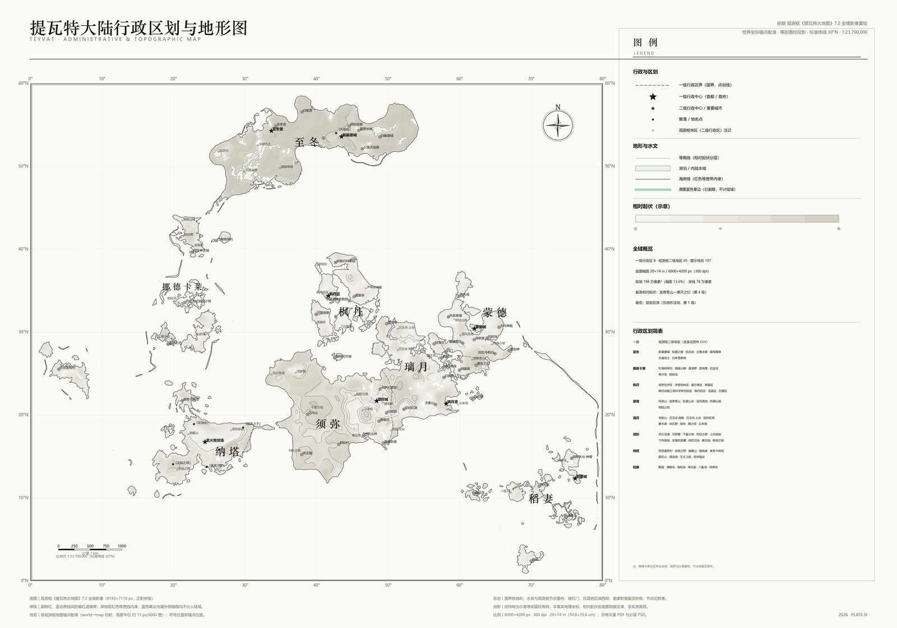

# 提瓦特大陆行政区划与地形图

以观测枢《提瓦特大地图》8K 影像为底，按 301 个锚点配准后重绘的 A3 地图。

## 内容

- **行政区划**：8 个一级行政区、65 个二级行政区、107 个地名；
- **地形**：陆域按底图明度反演为“相对起伏”6 级分层，叠加等高线；
- **地图要素**：经纬网（标准纬线 30°N）、比例尺 1:2,700,000、指北针、图例与行政区划缩表；
- **规格**：A3 / 300 dpi / 6000×4200，另附 PDF 与分层 PSD。

## 文件

| 文件 | 说明 |
|---|---|
| `preview.jpg` | 预览图（1600×1120） |
| `teyvat-topo-6000.png` | 成品 PNG（6000×4200，300 dpi） |
| `teyvat-topo.pdf` | 可编辑矢量 PDF |

分层 PSD（91 MB）未上传，仓库只保留 PNG / PDF / 预览图。

## 说明

- 灰色分层为相对起伏示意，**非实测高程**；
- 行政区划为同人整理，非官方设定；
- 陆域保留源图连续地形，海侧擦除滤镜带后沿岸线矢量描边。

## 在线查看

仓库自带 `index.html`，可直接打开浏览：
<https://logicx200.github.io/works/teyvat-topo-map/>
