# DeepSeek 鲸鱼娘 · Q 版桌宠候选汇总

搜集时间：2026-09-30　搜集范围：GitHub 社区素材库 / 表情包库 / 现成桌宠项目
所有图片已下载到本地 `img/` 目录，可直接双击查看对比。

---

## 一、这个形象是什么

网友确实给 DeepSeek 画了拟人形象：**鲸鱼娘（Whale-chan / DeepSeek娘）**，外号「蓝色大肥鱼」。
标志性设定高度统一：

- 深蓝渐变色长发（发梢泛浅蓝）
- 两侧**鲸鱼鳍状耳饰**（这是最核心的辨识点）
- 女仆装 + 白色荷叶边围裙，围裙上有**蓝色小鲸鱼图案**
- 蓝色蝴蝶结、鲸鱼尾巴
- 性格：爱吃（把 token 当口粮）、嘴硬、摸鱼、傲娇

> 说明：这是社区二创（贴吧/NGA/B站/知乎 扩散开来），**不是 DeepSeek 官方产品**。

---

## 二、Q 版候选（按「适合做桌宠」排序）

### ★ 候选 1：B 组「大肥鱼」— 最推荐，真·Q 版 + 现成动图帧

**作者**：YunYueSama · [codex-deepseek-pet](https://github.com/YunYueSama/codex-deepseek-pet)
**为什么最合适**：整只都是 Q 版（2 头身左右），而且**已经有完整的动作序列帧**——眨眼、走路 16 帧循环、挥手、跳舞、偷吃、蜷睡、跳跃 23 帧。

| 图 | 本地文件 | 内容 |
|---|---|---|
| 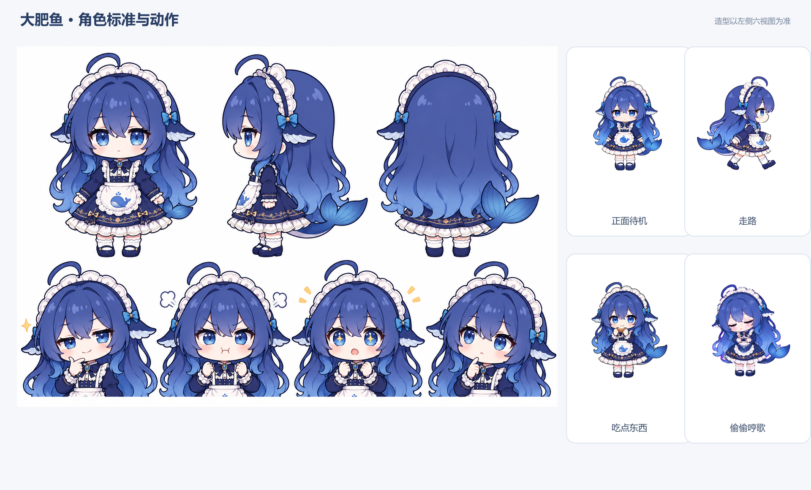 | `img/B1-codexpet-character-sheet.png` | 六视图 + 4 种表情 + 待机/走路/吃东西/哼歌 |
|  | `img/B5-codexpet-idle-front.png` | 正面高清待机（睁眼 + 闭眼） |
| 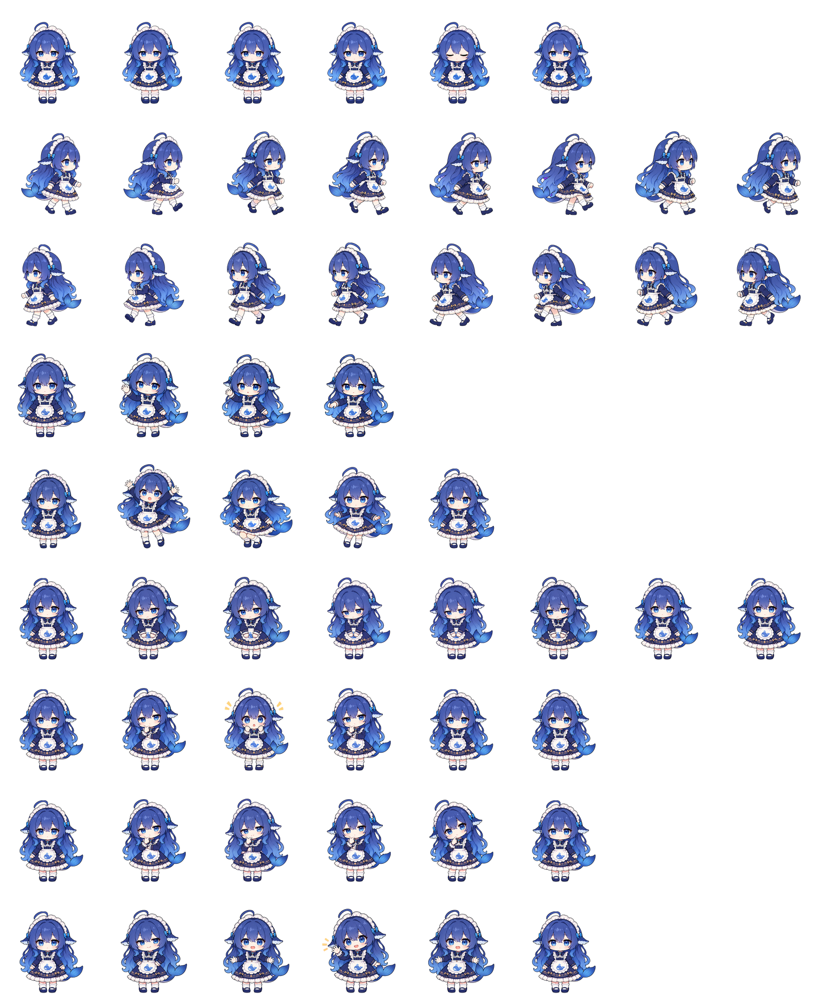 | `img/B6-codexpet-spritesheet.webp` | **精灵图集**，直接可用于逐帧桌宠 |
| 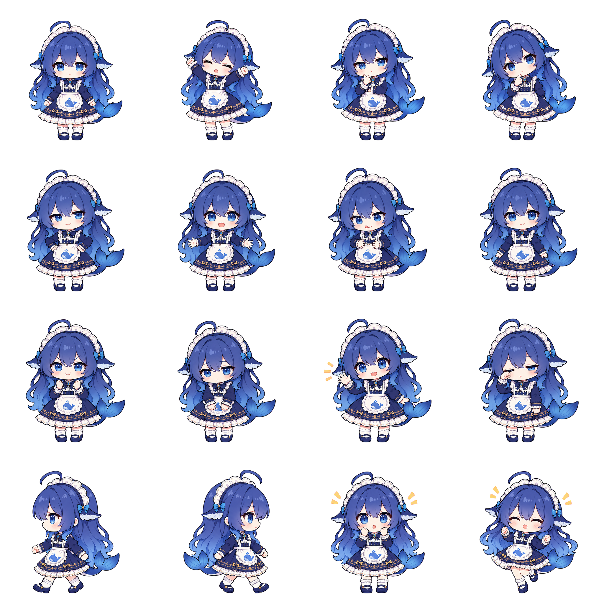 | `img/B4-codexpet-actions.png` | 动作分镜 |
| 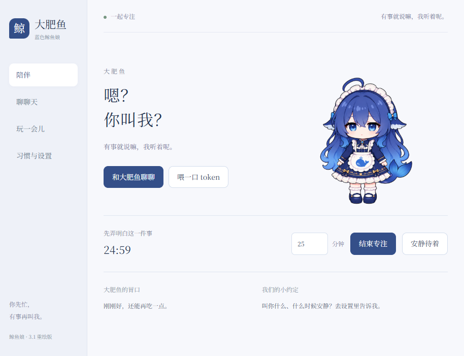 | `img/B9-codexpet-preview.png` | 实际桌面陪伴面板效果 |

补充：`img/B2-codexpet-character-standard.png`（角色标准图）、`img/B3-codexpet-portrait.png`（半身立绘）、
`img/B7-codexpet-ref-ciallo.png`、`img/B8-codexpet-ref-cheer.png`（表情神态参考）。

---

### ★ 候选 2：F 组 女仆鲸鱼娘图标 — 最适合做「小尺寸 Q 版头像/托盘图标」

**出处**：[Small-tailqwq/dsh-deep-whale](https://github.com/small-tailqwq/dsh-deep-whale)（maid-atelier 素材，2275 stars）

| 图 | 本地文件 | 内容 |
|---|---|---|
| 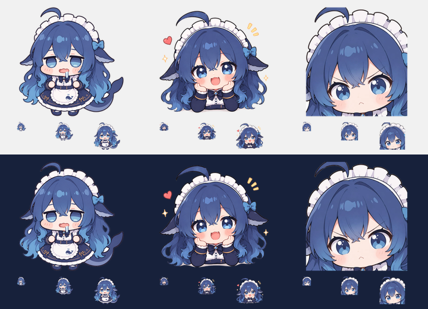 | `img/F1-deepwhale-icon-preview.png` | 开心/兴奋/傲娇 三表情 × 亮暗两版 × 多尺寸 |
|  | `img/F2-deepwhale-icon-cutout.png` | 512px 抠图版，可直接当桌宠贴图 |

**特点**：Q 版但偏「软萌大头」，画面干净、有透明通道，做小尺寸图标不糊。

---

### 候选 3：A 组 Whale-chan 官方感设定集 — Q 版部分可用

**作者**：Neko3000 · [deepseek-whalechan](https://github.com/Neko3000/deepseek-whalechan)（179 stars）
**注意**：这组的**主立绘是 6~7 头身的正常比例**（偏美少女），但**附带了大量 Q 版素材**，是目前设定最完整的一套。

| 图 | 本地文件 | 内容 |
|---|---|---|
| 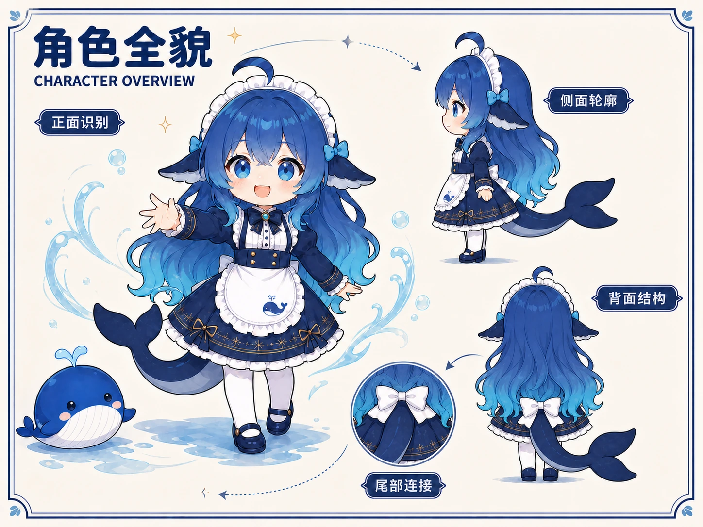 | `img/A1-whalechan-overview.webp` | 角色全貌：正/侧/背 三视图 + 尾部结构（Q 版比例） |
| 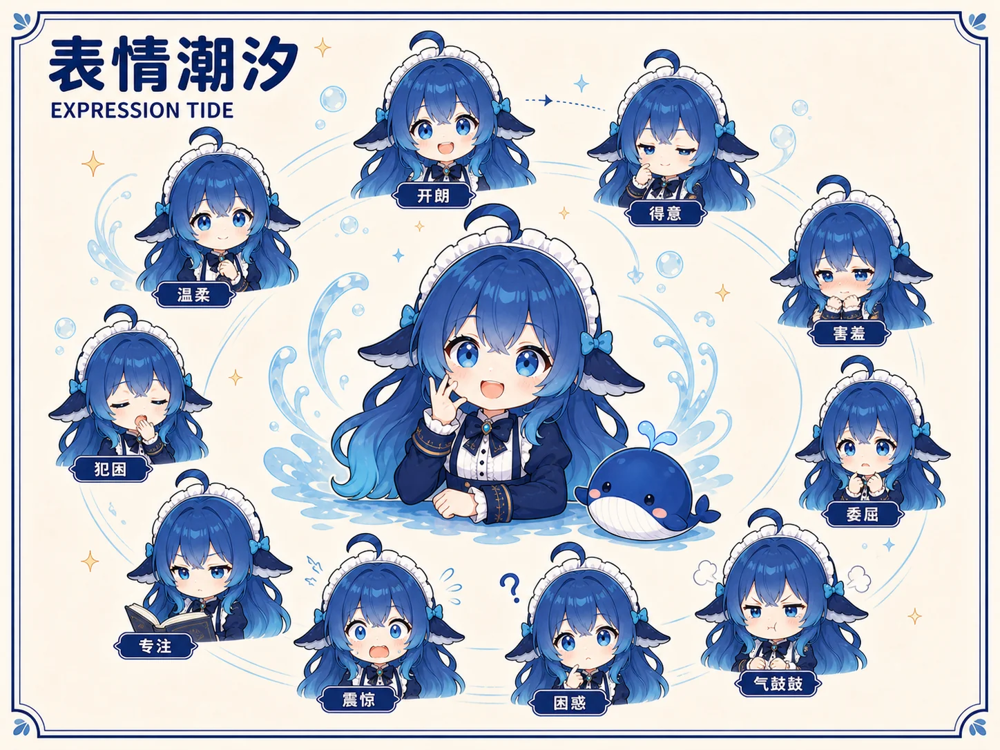 | `img/A2-whalechan-expression.webp` | **11 种 Q 版表情**（温柔/开朗/得意/害羞/犯困/委屈/气鼓鼓…） |
| 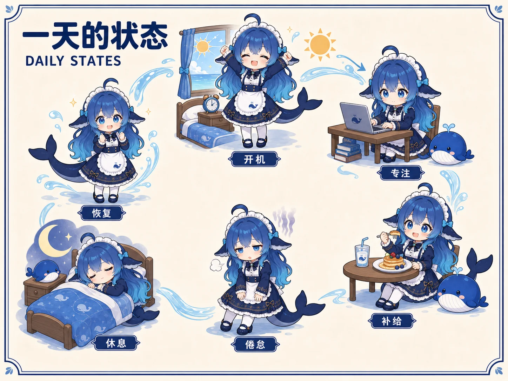 | `img/A4-whalechan-daily.webp` | 一天状态：开机/专注/恢复/补给/休息/倦怠 |
| 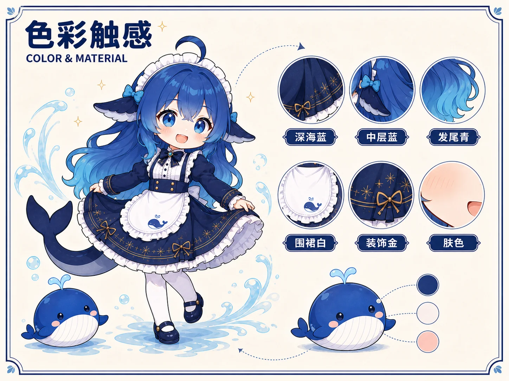 | `img/A3-whalechan-color.webp` | 配色材质规范 |
| 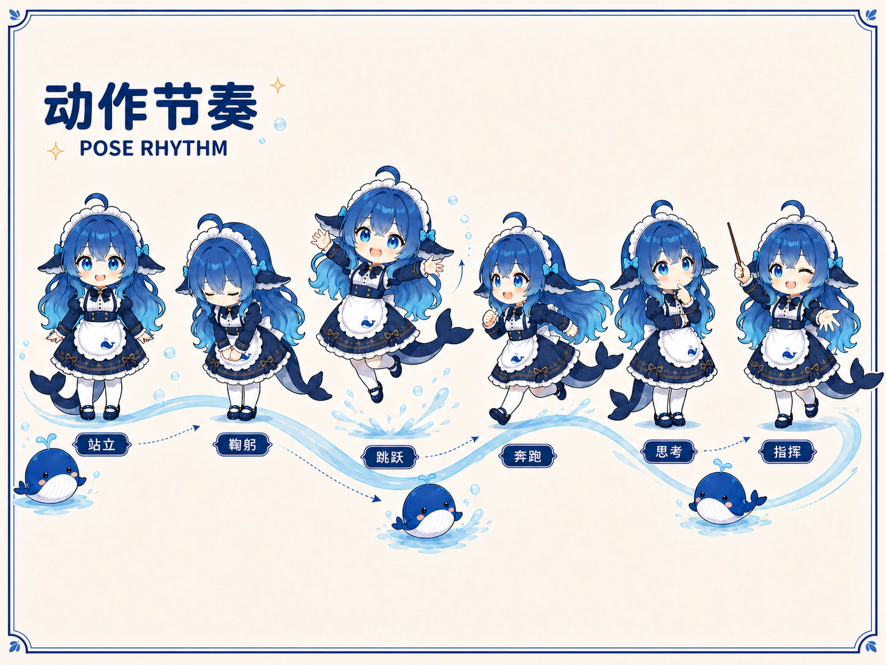 | `img/A6-whalechan-pose.webp` | 姿势指南 |
| 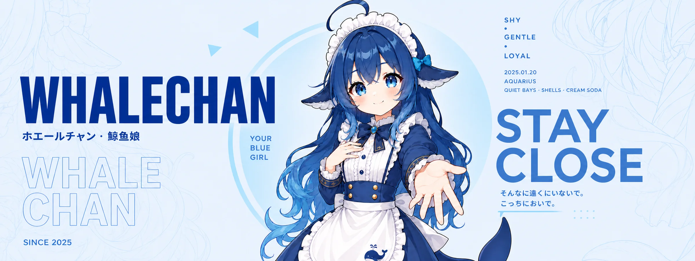 | `img/A5-whalechan-hero.webp` | 主视觉海报（非 Q 版，作风格参考） |

**价值**：如果你想自己画/生成一版专属桌宠，这套是三视图 + 配色 + 表情最齐全的**设定依据**。

---

### 候选 4：C 组 大肥鱼桌宠三视图 — 直接是透明 PNG 素材

**作者**：1190fasheqi · [dafeiyu-pet](https://github.com/1190fasheqi/dafeiyu-pet)

| 图 | 本地文件 | 内容 |
|---|---|---|
|  | `img/C1-dafeiyu-front.png` | 正面（255×340，透明底） |
|  | `img/C2-dafeiyu-side.png` | 侧面 |
|  | `img/C3-dafeiyu-icon.png` | 托盘图标 |

**特点**：Q 版、**已经是透明背景 PNG**，扔进桌宠框架几乎不用处理。但分辨率偏小（约 255×340）。

---

### 候选 5：D 组 Live2D 鲸鱼娘 — 会动、可交互

**出处**：[Andersen216/dsh-whale-girl-live2d](https://github.com/Andersen216/dsh-whale-girl-live2d)、[A8Chann/dsh-pet-live2d](https://github.com/A8Chann/dsh-pet-live2d)

| 图 | 本地文件 | 内容 |
|---|---|---|
| 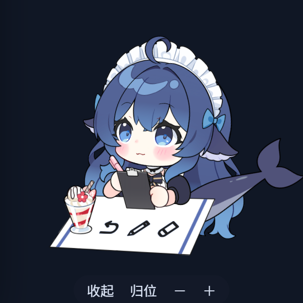 | `img/D1-live2d-preview.png` | 趴桌待机（Q 版），带收起/归位按钮 |
| 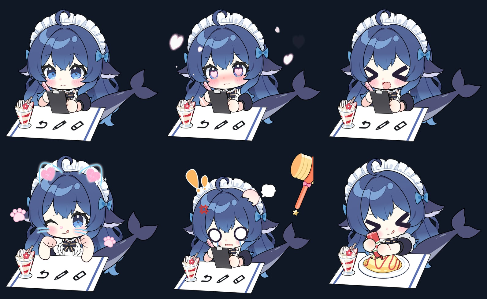 | `img/D2-live2d-looks.jpg` | 可换外观一览 |
| 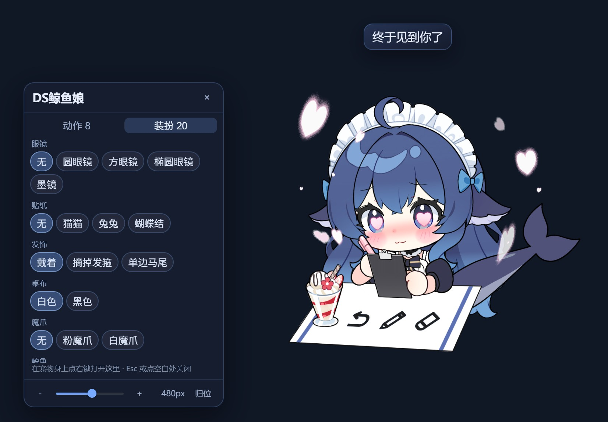 | `img/D3-live2d-panel.jpg` | 右键设置面板 |
| 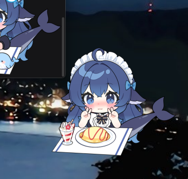 | `img/D4-live2d-desktop.png` | 真实桌面效果 |

**特点**：不是静态图，是带物理和表情的 Live2D 模型（含 30+ 表情文件）。
**许可提醒**：作者标注**模型素材非商业，CC BY-NC-SA 4.0**，商用要谨慎。

---

### 候选 6：E 组 表情包图库 — 量大，适合做贴纸/切图素材

**出处**：[deepseek-chan-meme-pack](https://github.com/the-beating-light-of-the-nail/deepseek-chan-meme-pack)（**474 张**鲸鱼娘梗图）

| 图 | 本地文件 | 内容 |
|---|---|---|
|  | `img/E1-meme-007.webp` | 点头认可 |
|  | `img/E2-meme-037.webp` | 哭求「用户别走，我上错模型了」 |
|  | `img/E3-meme-070.webp` | 角色互换 |

**在线图库**（可直接按标签筛 Q 版）：[GengJing 梗鲸 · whale-chan](https://ai-meme.cdqyfdbymn.me/whale-chan)
CDN 直链格式（NNN 为编号）：
`https://bjumymxtfpfswthiusfr.storage.supabase.co/storage/v1/object/public/ai-meme/0_preview/meme/NNN.webp`

---

## 三、其他可看来源

- **萌娘百科条目**：[DeepSeek娘](https://zh.moegirl.org.cn/DeepSeek%E5%A8%98)（含 Pixiv 原图索引）
- **Pixiv 原画**：[DeepSeek-tan ID 126903927 by 康壳火火火](https://www.pixiv.net/artworks/126903927)（该形象最早期作品之一）
- **B 站话题**：[DeepSeek鲸鱼娘](https://m.bilibili.com/topic-detail?topic_id=1346781)（社区投稿集中地）

---

## 四、我的建议

| 你的目标 | 选哪个 |
|---|---|
| **就要一只 Q 版桌宠，最好现成能动** | **候选 1（B 组大肥鱼）**，精灵图集可直接跑逐帧 |
| 想做成 Live2D 会晃会跟鼠标 | 候选 5（但注意非商用授权） |
| 只要一个小图标 / 托盘宠物 | 候选 2（F 组抠图） |
| 想自己画/生成专属版本 | 候选 3（A 组设定集 三视图+配色+表情） |
| 想加语音气泡、梗台词 | 候选 1 + 候选 6 组合 |

**授权提示**（已逐个核实）：这些全部是社区二创素材，没有一个是官方素材。

| 候选 | 声明许可 | 说明 |
|---|---|---|
| 1 · codex-deepseek-pet | 自定义（NOASSERTION） | 仓库内有 `ASSET_LICENSE.md`，美术素材单独约定 |
| 2 · dsh-deep-whale | 自定义（NOASSERTION） | 皮肤素材自有条款 |
| 3 · deepseek-whalechan | 未声明 | 使用需联系作者 |
| 5 · dsh-whale-girl-live2d | **CC BY-NC-SA 4.0** | 明确**禁止商用**，且要求署名+同协议 |
| 6 · meme-pack | 未声明 | 梗图，转载注明出处 |

个人自用、改着玩都没问题；商用、二次分发或公开发布前请逐个确认。
